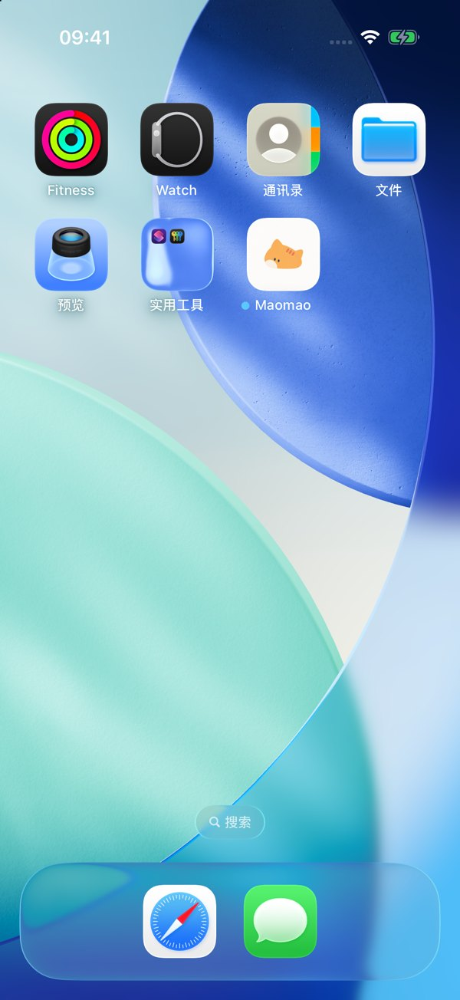
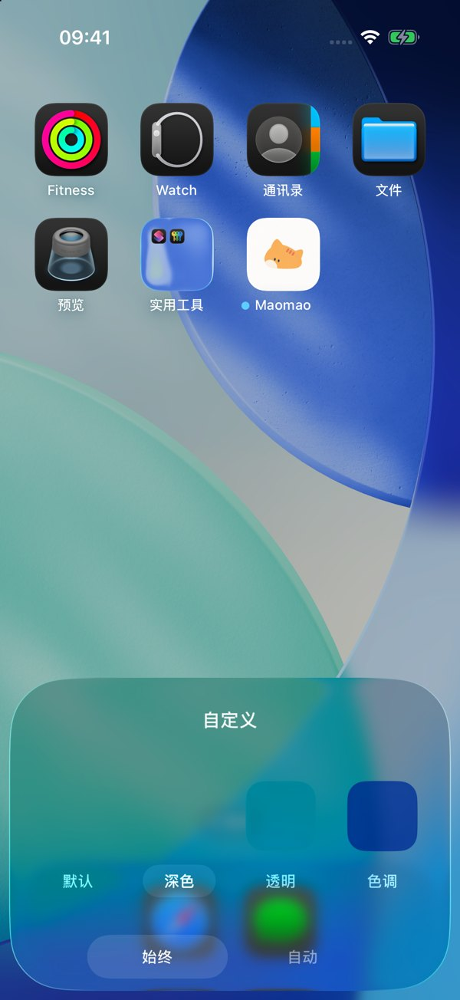
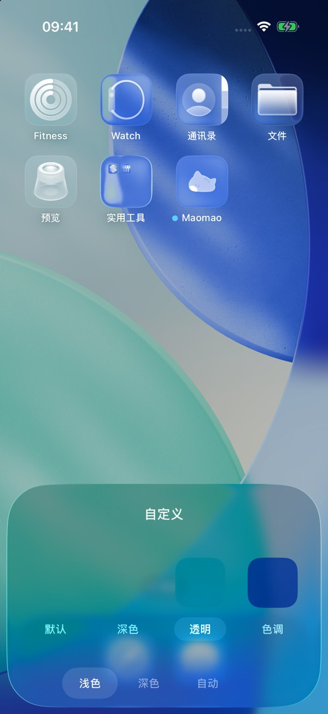
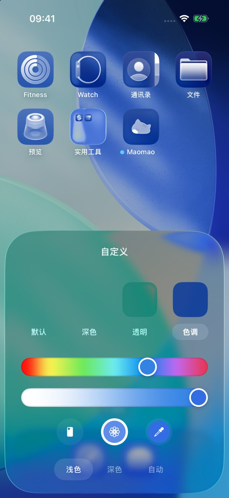
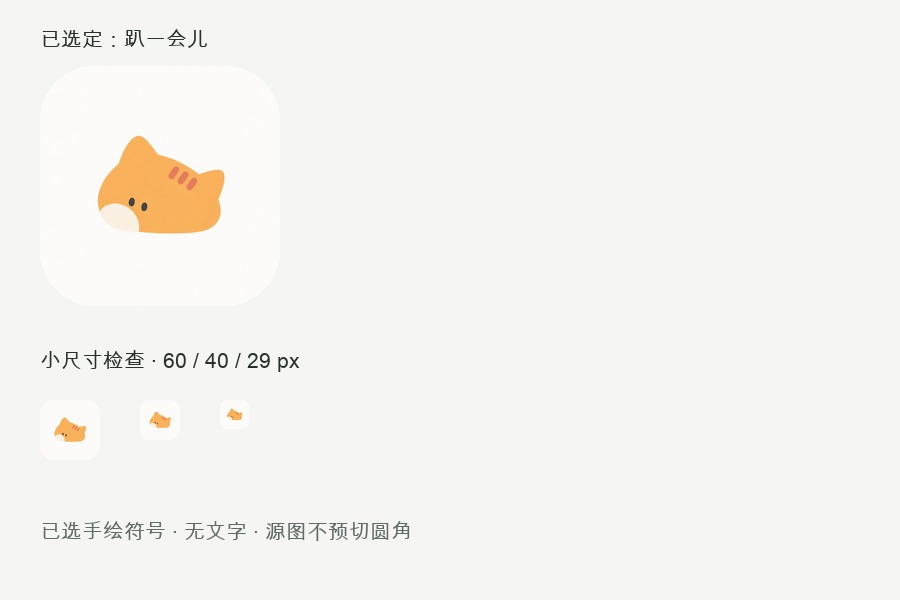

# 正式 App 图标 · 实施验收

2026-10-14：用户选定 rounded-v12 第三款“趴一会儿”，已接入常规 AppIcon。真机继续暂缓，未提交/推送。

## 当前资源

- 源图为 assets/app-icon/rounded-v12/C-rest.png，保留用户选定的造型、配色与留白，仅从1254等比缩放至1024并转RGB。图像由内置 image_gen 生成，提示词在源目录 README。
- 常规图标1024×1024、RGB、不透明、无预切圆角。来源与输出哈希见 source.json、checks.json。
- 取消旧大头照的深色和着色资源映射，避免外观切换时出现旧设计；旧文件留存但不被资源目录引用。本轮没有另制专用深色/着色稿，系统外观本轮已实测，见下文。

## 验证与边界

- check_app_icon.py 检查通过；iPhone17Pro模拟器构建通过，已安装。
- 已直接查看构建产物 AppIcon60x60@2x.png，确认编译产物为新款。
- 本轮通过 Device Hub 定位第二页，确认主屏幕与 App 资源库均显示新图标，旧缓存问题已解决。默认、深色、透明、色调四种图标模式已逐一切换并截图，均无旧图、缺图或裁切；检查后恢复默认图标与浅色系统。
- 深色图标模式保留米白底（未提供专用深色稿）；透明与色调由系统转换，轮廓可识别但眼睛和额纹对比降低。这是当前表现边界，不宣称所有壁纸和色调组合均通过。
- 真机、全部壁纸/色调组合及商店上传未验收。

| 默认 | 深色 | 透明 | 色调 |
|---|---|---|---|
|  |  |  |  |

## 复核

运行 python3 tools/check_app_icon.py。旧 tools/render_app_icon.mjs 属于已否决3D大头照生成器，不可用它覆盖本轮选定资源。
