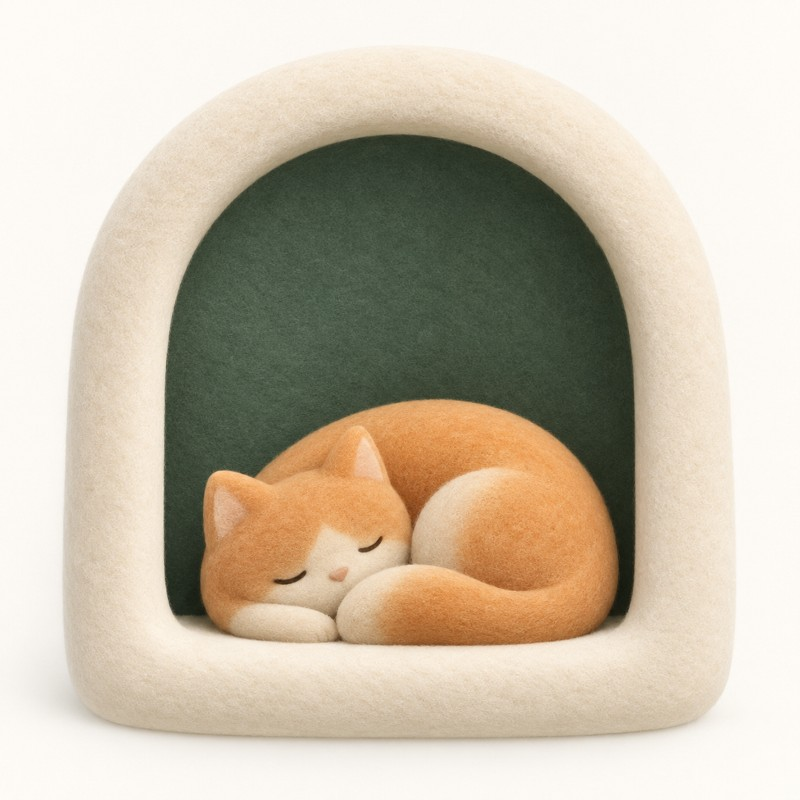

# 小窗里的日常 · App图标新方向

2026-10-13：用户否决团子大头照图标，要求重新设计、符合产品理念。此稿已被用户否决，未替换App资源；用户随后明确选择简洁品牌符号方向；旧大头照不得记为已确认。真机继续暂缓，未提交/推送。

## 设计表达

一扇柔软的拱窗，里面有只自在蜷睡的小猫。窗代表你们共享的小世界，蜷睡表达猫有自己的生活；陪伴安静存在，用户可以随时来坐坐。以完整意象表达低压力关系，减少单纯卖萌的大脸主体。

- 有特色：拱窗与蜷猫构成一个整体，与产品的生活空间和低压力陪伴相连。
- 好看：暖白毛毡框、深绿窗内与杏橙猫形成层次，保持大块轮廓和留白。
- 耐看：单一主体、无文字或装饰堆叠；细绒细节在正式小尺寸落地前仍需进一步核对。

使用内置imagegen新生成，不是正式GLB的渲染，也不替代角色基准。原图1254×1254、RGB；生成输出未严格遵循请求的1024尺寸，当前明确作为方向稿保存，尚未制作AppIcon的正式尺寸和深色/着色变体。

- [原始设计图](../../assets/app-icon/window-v2/source.png)
- [完整提示词与生成方式](../../assets/app-icon/window-v2/prompt.md)
- [来源哈希和尺寸](checks.json)

