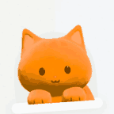

# 连续头像动作 · 实施与验收

2026-10-13：已实现、已接入，模拟器动作实拍与减少动态效果复核通过；歪头修正版自然度已获用户确认。真机按用户要求继续暂缓，未提交/推送。

## 实现范围

- 从正式3D团子GLB离线渲染，使用现有blink形态键及两节颈骨/头骨。身体、爪子与已确认的小窗布局保持原样，不改世界层模型或动作。
- 眨眼10帧、30fps、约0.33秒：缓入闭眼、短暂停留、稍慢睁开。歪头73帧、约2.43秒，单侧侧倾8°，0.8秒进入、0.65秒停留、0.95秒回正，伴随极小幅低头与一次眨眼；没有整张头像的摇摆或缩放。
- 首次等2–4秒；动作间隔随机4–7秒，每3–5次眨眼后偶尔歪头，避免机械匀速循环。UIKit播放帧序，静止等待期间没有逐帧SwiftUI刷新。
- 接我的小窗、首页头像、聊天最新猫消息组和等待头像。历史消息头像保持静止；超时头像保留安静姿势。隐藏的首页控件与等待头像不播放。
- 离屏/后台/减少动态效果取消调度并回到同一待机图；所有实例共享帧图。83帧256×256透明PNG共5,131,548字节，像素RGBA体积估计20.75MiB（不代表实测进程峰值）。

## 验证

- [素材清单](assets.json)：正式模型SHA256、每帧SHA256/时间/大小；[检查](checks.json)：83帧尺寸/透明边界正常，头耳无顶部/左右裁切；动作首尾、跨动作待机逐像素相同。
- `web/tests/avatar-motion.test.mjs`：端点姿势/速度、闭眼完整性、单侧侧倾/停留/无左右偏转与连续性验证通过。`sh tools/check_all.sh`全套通过（37项网页测试、Swift逻辑、跨端规则、前后端类型检查），首版模拟器构建与聊天页面复核通过；歪头修正另跑资源检查、动作测试、网页类型检查与模拟器构建，`git diff --check`通过。
- iPhone17Pro/iOS26.5模拟器构建并安装；我的页录屏正常包含闭眼及歪头。开启模拟器系统ReduceMotion设置并重启App复录，眼部暗像素1035–1048（压缩波动），正常动作106–1062；[量测](simulator.json)。测试后恢复原设置。
- 原始模拟器视频、抽帧与构建日志留在`/tmp`，不进仓库。应用进入后台与离屏的取消路径做代码核对，未将其写成真机操作验收。
- 动图使用调试参数`-avatarReview`缩短动作之间的等待，动作本身时长不变。正式随机间隔不由这段缩短预览证明。

## 复现

Vite在127.0.0.1:5173启动后，用本机Playwright运行`tools/render_avatar_motion.mjs`；`python3 tools/check_avatar_motion.py`复核资源并生成素材预览。原生组件位于`ios/Maomao/DesignSystem/AnimatedCatPortrait.swift`。Debug启动参数`-avatarReview -script '500:screen:me'`用于缩短等待实拍；正式版本不会启用该参数。

## 同日歪头修正

按用户反馈替换摇头为单侧歪头，复核73帧动作的首尾无跳变、头耳不裁切，更新模拟器实拍预览。[歪头实拍量测](tilt-simulator.json)覆盖807帧，睁眼样本眼线倾角约-3.43°至-11.70°（含小窗固定倾角），与约8°单侧歪头一致。原37项全套检查与减少动态效果证据对应首版播放组件；此次仅改变动作采样与资源，播放组件未改。真机仍暂缓，未提交/推送。

用户确认：随后明确“这版可以”，头像歪头修正版观感通过；真机仍暂缓。本结论只覆盖头像动画，不替代世界层动作验收。
