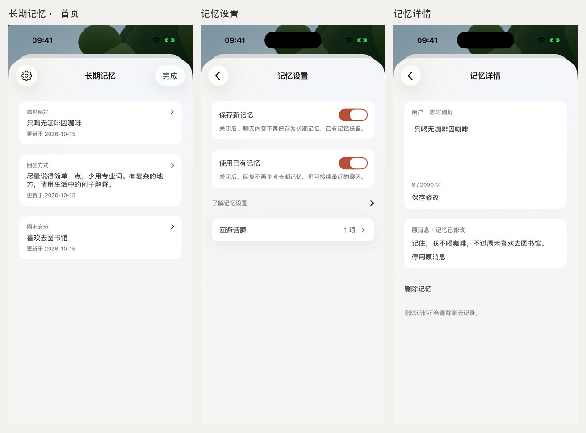
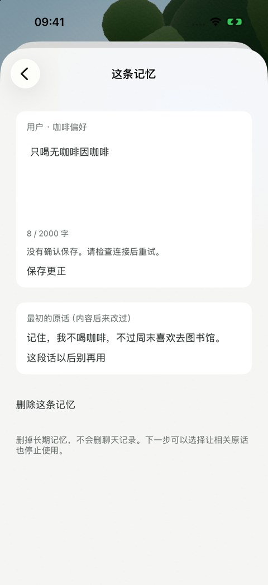

# 记忆第一批验收记录

日期：2026-10-15。状态：**功能已实现，本机与模拟器检查通过，用户已允许进入第二批。真实模型抽验因现有凭证无效未完成，真机继续暂缓。第二批结果见后续报告。** 未提交、未推送。

后续状态：[第二批相关记忆查找](../memory-recall-review/验收报告.md)已实现并通过受控链路验证。以下保留第一批的检查记录。

## 现在可以做什么

从“我的 → 长期记忆”进入，能看到真实保存的内容、更新时间和原话；打开一条后可以更正、删除，或让整段原话停止参与后续聊天。首页以记忆列表为主，齿轮进入“记忆设置”：可控制“保存新记忆”“使用已有记忆”，并进入“回避话题”查看或取消回避。

- **更正**：新值立即生效，同方面其他版本退为历史；迟到的旧候选不能覆盖。保存成功才返回列表，失败保留草稿。
- **删除**：删除同一方面所有长期记忆正文，留下无正文的阻断凭证；不会删原聊天。可以同时停用相关原话。
- **停用原话**：按整条消息处理，先展示影响范围；派生回复、关联记忆与依赖的表达习惯/临时状态一起停用。聊天仍可看，并标“已停止使用这段话”。旧回复没有来源记录时保守停用，预览会明确标出“来源无法核对”。
- **回避话题**：只接受猫的消息；相关旧输入不再作为普通聊天背景注入，话题边界另外保留。撤销边界不会恢复已删除或已停用的内容。
- **开关**：服务端保存；关闭整理期间的消息不补记，关闭前还未完成的提取也作废。关闭参考已有记忆不清除最近聊天，也不删除已有记忆。
- **日记防绕过**：当前日记没有可核验的消息来源 ID，暂不使用客户端传来的聊天/碎片正文；远端模式本地兜底也一样。院子事实仍能生成日记。

## 验证到哪一步

| 检查 | 结果与证据边界 |
|---|---|
| 一键仓库检查 `sh tools/check_all.sh` | 通过；跨端规则、Swift 世界逻辑、网页 37 项测试与前后端类型检查 |
| 后端独立验收脚本 `sh tools/test_memory_controls.sh` | 新建隔离 PG 数据库与临时 Redis，增量迁移、类型检查、**16 个测试文件 / 78 项全部通过**；使用受控模型 |
| 实际 HTTP/SSE 联调 | **5 类通过**：明确记忆在回复前保存、更正重新读取、删除同时停用原话、生成中停用后不再发布成功、两个开关独立。使用本轮独立账号、本机 Hono 服务与真实 PG；模型为 mock |
| iOS 构建 | iPhone 17 Pro / iOS 26.5 模拟器 Debug 构建成功 |
| 实际模拟器操作 | 打开列表/详情，输入长草稿，保存更正；断网保存显示失败且保留草稿，恢复连接重试成功；开关关闭后重启仍关闭；边界撤销后显示真实空状态；删除与停用的影响预览实际点开检查 |
| 数据一致性 | 验证旧候选不覆盖更正、删除不复活、来源停用阻断提取与原文注入、相关 Soul/状态失效、跨账号与角色限制、预览期间新聊天要求重核对、存量有效记忆保留而无效来源隔离 |
| 真实模型 | 尝试现有 DeepSeek 连接，返回 **401 凭证无效**。未得到有效回复，不能据此声称自然语言纠错、含糊澄清或“不要再提”的模型表达已通过真实模型验收 |
| 真机 | 按用户要求暂缓；本轮没有真机验收 |

截图中的内容全部是合成验收数据，不是用户真实偏好。中文展示内容由隔离账号准备；实际键盘输入与保存测试使用 ASCII 草稿。UI 的删除/停用确认前预览已检查，最终删除与停用提交通过正式 HTTP 接口和自动测试验证；不将它写成手动点击最终删除按钮的证据。

模拟器实拍发现“键盘出现时失败提示落在下方”，已修为提交时收起键盘，错误紧邻保存按钮；修后再次断网实拍确认提示可见，恢复连接后成功保存。

## 同日界面调整验证

用户指出文案口语化、冗长，回避话题与长期记忆并列。现已改为“我的 → 长期记忆”单入口，首页仅展示记忆列表；齿轮进入记忆设置，再进入回避话题。两个开关改名为“保存新记忆”“使用已有记忆”，详细说明默认折叠。详情、停用预览及回避确认文案同步简化。

本次重新通过 iPhone 17 Pro / iOS 26.5 模拟器构建、`python3 tools/repo_check.py` 与 `git diff --check`。实际点击核对单入口、齿轮、设置/回避话题往返、折叠说明、记忆详情、停用影响预览、取消回避确认及取消操作。点击关闭保存开关后，HTTP 读取结果为 `learn=false,use=true`，再恢复为开启；重新进入设置仍显示正确值。截图为本轮实际模拟器页面，内容仍为隔离账号合成样例。

此次未改服务端契约，未重新运行前述78项后端测试和真实模型抽验；不把前一轮结果算作本轮重跑。随后用户确认并授权第二批，见上述后续报告。

## 实现要点与复跑

- 数据库迁移：`server/drizzle/0005_military_veda.sql`。增量增加开关、每猫记忆版本、消息使用许可、回复输入来源、更正水位；不清理现有账号数据。
- 服务端规则：`server/src/memory/control.ts`、`server/src/api/memories.ts`、`server/src/worker/memory.ts`。来源许可、编辑水位和删除阻断在事务内复核。
- 回复前明确记忆操作先尝试保存，后注入保存结果；一般闲聊仍异步整理。含糊更正返回澄清建议。受控模型下已测流程，真实模型理解质量待补验。
- 输入、输出与来源变更共用猫的事务锁；每次流式输出和最终保存检查记忆版本。已经发出的字无法收回，变更之后不继续输出旧上下文。
- 影响预览绑定记忆版本与消息水位，期间有新聊天也必须重新核对。来源失效标记必须保留；不能把服务端回退到不识别这些标记的旧代码。
- iOS 页面：`ios/Maomao/Features/Me/MemoryCenterView.swift`。使用原有字体、颜色和圆角；只在后端确认后显示成功。切换后端会关闭管理页，避免旧账号页面残留。
- 自动复跑：`sh tools/test_memory_controls.sh`（要求本机 `maomao-postgres-1` 可用）。创建的独立验收库保留供追查，不迁移默认开发库。
- HTTP 复跑：启动隔离库的 mock API 于 8788，再以同一 `DATABASE_URL` 和 `MODEL_PROVIDER=mock` 运行 `pnpm --dir server exec tsx scripts/test-memory-http.ts`。该脚本会拒绝非验收库。
- 模拟器样例：`server/scripts/memory-review-seed.ts`，只允许 `maomao_memory_review_` 库；账号凭证仅写本机临时文件，不进仓库。

## 还需要你看什么

本轮先看页面与四种操作的含义是否符合预期。真实模型凭证恢复后还需补实际对话抽查；不把受控模型结果当作真实模型质量保证。第二批“按话题寻找旧记忆”现已见后续报告；聊天记录本身删除、完整日记来源链与日记系统重做尚未启动。
