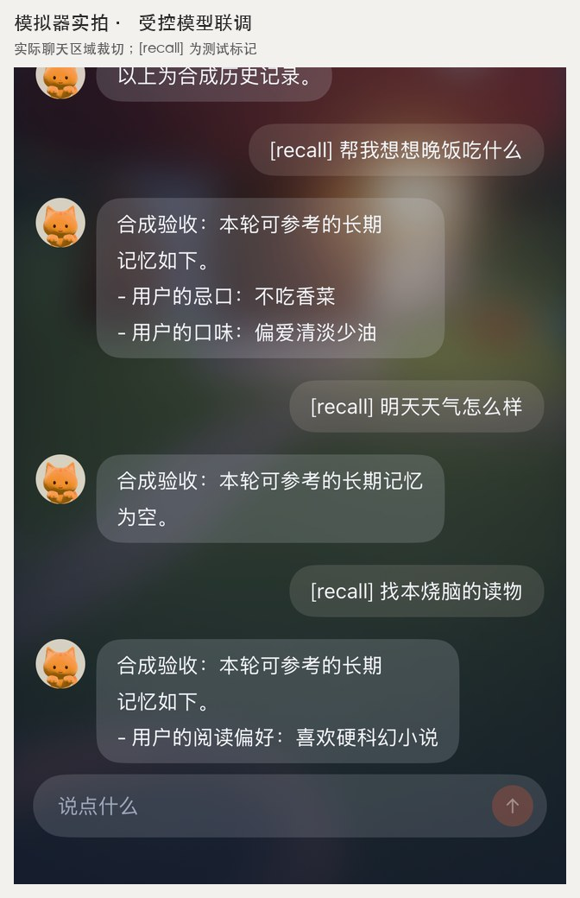

# 记忆第二批验收记录

日期：2026-10-15。状态：**相关记忆查找已实现，本机与模拟器受控链路验证通过，用户2026-10-19表示没有问题并授权继续项目；真实模型凭证无效，语义质量未验收。** 用户已授权第二批，未提交、未推送；真机继续暂缓。

## 这次的实际变化

团子回复前会按当前话题查找允许使用的旧记忆。饮食偏好不必恰好在最近几十条之内；聊天气等无关问题时，不再把近期记忆整批带入。第一批记忆页的层级和文案沿用确认版。

先过滤来源、归属、状态、回避与敏感范围，再做查询扩词与本地排序。最多8条、总计2400字符；更正以当前值为准，删除、停用和关闭使用开关均先于查找。明确保存的回答方式、称呼等表达偏好可作持续背景。

扩词复用已有模型，最多192输出token、2500毫秒等待、无重试；故障退回本地相关查找。辅助查找整条路径异常时正常聊天不带旧记忆，取消整轮则立即停止。详细约定见[第二批决策](../../docs/决策/2026-10-15-记忆第二批.md)。

## 验证记录

- 固定对照：126条合成记忆、8个问题，相关旧偏好6条，旧取用方式漏掉6条，新方式找到6条；无关问题没有注入记忆。扩词受控，只证明排序链路。完整结果见[固定用例对照](固定用例对照.json)。

| 检查 | 结果与证据范围 |
|---|---|
| 后端完整测试 | 独立PG/Redis，**19个文件、102项全部通过**，含第一批78项和第二批24项；类型检查通过 |
| 正式HTTP/SSE | **7类通过**：旧饮食偏好、换说法找旧阅读偏好、无关问题、更正、删除、停用来源、关闭使用开关；正式API/真实PG/Redis，扩词与回复均受控mock，见[联调记录](HTTP联调.json) |
| 实际模拟器 | iPhone 17 Pro / iOS 26.5，**3个请求通过**：晚饭找到两条旧饮食偏好，天气不带长期记忆，烧脑读物找到硬科幻偏好；从App发出，经正式HTTP/SSE与PG核对，见[链路记录](模拟器链路.json) |
| 来源证明 | 这三次实际请求选中的旧来源均不在当轮最近30条消息中；`memoryIds`与预期相符，`contextSourceIds`包含真实旧来源。证明由长期记忆查找进入，而非复述近期原话 |
| 仓库全套检查 | `sh tools/check_all.sh` 全部通过，含跨端规则、Swift世界逻辑、网页37项测试与前后端类型检查；`git diff --check`通过 |
| 真实模型 | 现有DeepSeek返回**401凭证无效**，单次探测后停止；没有真实模型理解或自然表达通过的证据，见[探测结果](真实模型检查.json) |
| 真机 | 按用户要求暂缓。本轮iOS代码与工程文件未改，使用前一轮已构建的App连接新隔离后端，未声称重新构建或真机通过 |

所有内容为合成验收数据。中文问题通过App调试启动脚本发送；重启后从服务器恢复已有对话，再发下一题。回复中的“合成验收”和`[recall]`明确标注受控模型用途，只回显实际到达模型的记忆，用来验证链路，不能当作正式自然对话样例。没有新增产品文案或管理页。

## 本轮发现和修复

- 查找服务冷却期间，整轮取消信号不能被当成普通本地降级。已在进入查找前检查取消，并验证取消继续向上传播。
- 本机并发跑19个数据库测试文件时，连接/CPU竞争导致多个旧测试超时。验收脚本改为单文件并发、普通mock逐字延迟1毫秒；故障/慢流标记仍保留原规则。最后完整102项通过，不以此前超时轮次冒充通过。
- 合成历史增加已有结束回复，避免后台把准备的旧历史当新聊天重提取。实际记忆变更发生在查找期间时，仍验证旧上下文在首字前失败，不输出旧值。
- 修改第一批更正测试的查询前提：先问咖啡再验证新值。第二批不再要求所有记忆无条件进入每一轮，旧值不覆盖的断言保留。
- 首轮HTTP在本机Redis阻塞读超时后断流，脚本补充正式续传；最终7类完整复跑均一次流完成，续传次数为0。没有为通过测试改宽生产Redis超时或记忆使用规则。

## 效果和开销

固定用例仅说明当前合成集合：126条记忆中，8个问题需要的6条旧偏好，旧按近期取用方式找到0条，新方式找到6条、带入无关记忆0条。不将它写成真实语义准确率或任意话题保证。

最终HTTP联调7个请求耗时约2.01～2.50秒，包含完整受控回复链路；6次mock扩词调用已按当轮范围记录，关闭使用时0次。真实模型的延迟、费用与理解效果尚不能测定；代码上限是每轮至多一次扩词、192输出token、2500毫秒等待、0次自动重试，不承诺取消后供应商绝对零费用。

本地先提供有限日常同义主题的降级；新模型词只用于排序，实际注入正文必须来自当前有效记录。其他查找路径异常时不注入旧记忆，正常回复仍能完成；测试同时覆盖删除、停用、跨账号、敏感范围、冲突、回避与查找期间并发变更。

## 复跑与范围

- `sh tools/test_memory_controls.sh`：独立PG与Redis，限制测试并发，跑类型检查及全部后端测试。
- `pnpm --dir server exec tsx scripts/evaluate-memory-recall.ts`：固定的受控排序对照，不访问模型。
- `server/scripts/test-memory-recall-http.ts`：仅允许验收库与mock，正式API需在8789运行。
- `server/scripts/memory-recall-seed.ts`：创建4条旧偏好和90条无关近期记忆的合成账号，凭证仅写本机/tmp。
- `MODEL_PROVIDER=deepseek pnpm --dir server exec tsx scripts/check-memory-recall-model.ts`：现有供应商的少量合成查询探测，不输出凭证。

本轮没有建立向量库或新增搜索供应商。当前是每只猫有效记忆的本地扫描，小规模验证不能外推为大规模性能结论；模型语义效果、回避话题的任意换说法遵守与真机各自需要证据。
