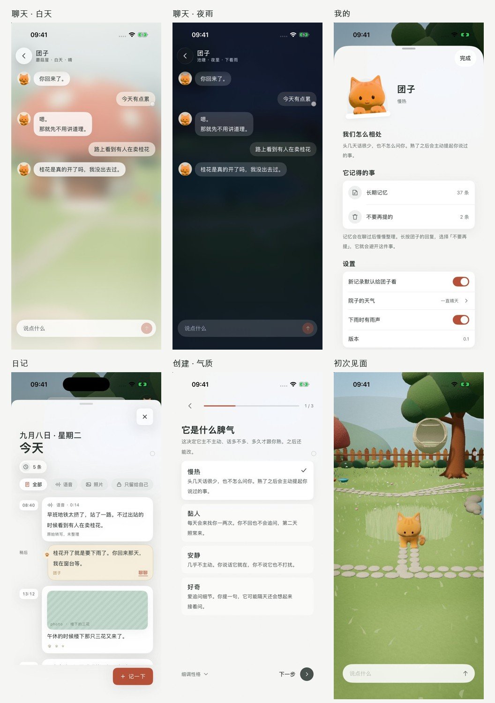
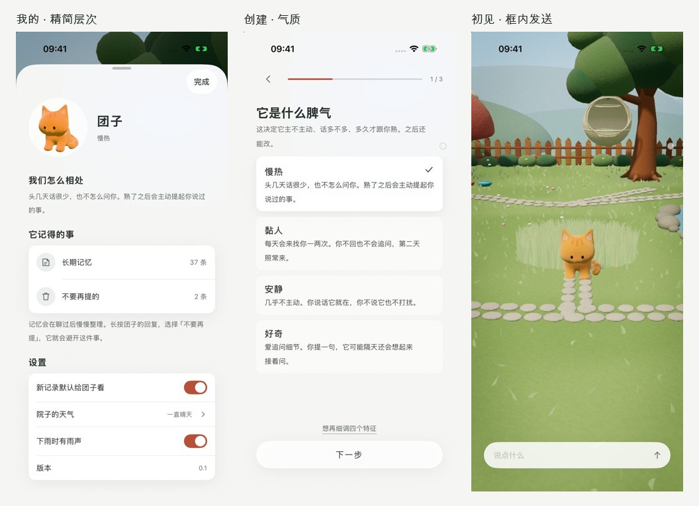
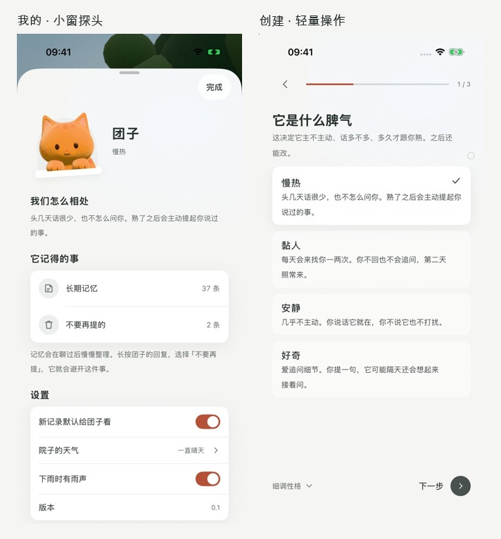

# 原生页面与3D配套 · 实施验收

日期：2026-10-13。状态：已接入，本机检查、构建与模拟器核对通过；用户已确认当前版页面视觉。真机按用户要求暂缓，未提交/推送。

## 实施

- 聊天背景来自正式3D小院：六地点×五时段×晴雨60张，不烘焙猫；运行时沿用原生地点、时段与天气事实，切换时柔和过渡，减少动态效果直接切换。移除旧2D天空、亮窗与二次调色。
- 从同一团子GLB渲染圆窗双爪特写、安静超时头像、全身创建/我的预览。初次见面在完整3D院子里渲染团子及接触阴影。共64张配套资源，来源模型与每张素材的哈希见[清单](metrics/assets.json)。
- 原生创建页、我的、日记纸统一米白毛毡/右上淡蓝光晕；中性文字、分隔线、图标底座与控件面成套调整，留言纸/木牌保留暖色。珊瑚略压明度以保证白字与小号文字可读。
- 聊天保留无描边、不发光的透明面与框内发送；长草稿最多五行，键盘上方保留发送热区。
- 收起未实现的聊天记录/语音/反馈、日记搜索、创建登录和设置空入口；我的展示实际气质，不再用固定话题数或承诺主动来访/可编辑记忆。远端消息删除暂不开放，本地模拟仍可删除。

## 验证结果

- `sh tools/check_all.sh` 通过：仓库规则、跨端一致性、Swift逻辑、35项网页测试、前后端类型检查。网页iOS打包与最终iPhone 17 Pro/iOS26.5模拟器构建成功，已安装。
- 64张素材哈希全部不同，尺寸与透明通道检查通过，总6,963,031字节；正式GLB哈希匹配。中性文字与页底对比度依次为12.22、7.48、5.03、4.61，珊瑚按钮白字5.03，见[指标](metrics/checks.json)。这组数值不冒充半透明聊天面全场景对比度测试。
- 实拍覆盖白天屋前聊天、夜雨池塘聊天、我的、日记、欢迎及三步创建流程；64张配套图的尺寸/哈希为程序验证，当前并未将60种聊天组合逐张做人工页面验收。
- 中文长消息自然折行，长草稿展开到五行，真实系统软键盘出现后输入、发送与最后一条消息完整可见；输入区提高布局优先级，键盘/输入高度变化后的滚动等待布局完成。原生入口切换由DebugScript驱动，聚焦由Debug参数触发；未宣称人工点击、长按菜单或拖动滚动均已验收。截图中的消息/日记包含已有本地演示数据，不代表真实模型表达验证。
- [页面对照](images/页面对照.jpg)、[键盘与长草稿](images/chat-keyboard.jpg)、[长消息](images/chat-long.jpg)，[截图哈希](metrics/screenshots.json)。最终输入布局修正后重拍键盘/长消息；同日用户反馈后重拍其余当前页面；旧选外观截图仅作历史留档，不再代表运行流程。

## 复现

启动 `pnpm --dir web dev --host 127.0.0.1` 后运行 `tools/render_ui_assets.mjs`，用 `PLAYWRIGHT_MODULE` 指定本机 Playwright 入口；素材从 `web/ui-assets.html` 离线渲染，该入口不进入iOS构建。`python3 tools/check_native_ui.py` 复核哈希、数量、尺寸与透明通道及中性文字对比度。安装最新模拟器构建后运行 `python3 tools/capture_native_ui.py`，原尺寸截图仅写 `/tmp/maomao-native-ui/`。

## 边界

头像当前为静态渲染，连续眨眼/摇头动画仍未交付；夜间与天气背景使用五档预渲染状态，未宣称逐秒光色连续。原有世界模型、动作和进度不因本轮UI配套重新验收。用户已确认当前版页面视觉；真机、iOS17与较旧设备验收暂未做。

## 同日细节调整

取消选猫步骤；创建按钮、命名输入与选中卡收为白色柔和表面；初见发送箭头并入输入条，去掉“先不说”；“我的”页压缩头区、减少重复标签并优化分区间距。最新本机全套检查、模拟器构建、`git diff --check`通过，已重新安装与实拍。此次实拍由调试入口切页，初见图为空对话视觉状态，不冒充完成创建全链路的交互验收。真机继续暂缓，未提交/推送。

## 同日第二次细节调整

头像改为双爪搭小窗、耳朵越过窗框的3D肖像构图。细调入口取消下划线，使用文字加展开箭头；气质和命名页的前进操作改为右侧文字加36pt圆箭头，整体热区至少46pt，取消整条白色按钮。模拟器构建、仓库检查与差异空白检查通过，重新安装并实拍我的/气质/命名页。视觉待用户确认，前段“细节调整”图片为上一版过程记录，以本段与最新页面对照为准。

## 用户确认与最终收尾

2026-10-13 用户确认“这版可以，先这样”。上文过程中的“待确认”以此结论为准；不扩张为全部设备/场景或手动交互验收。当前确认图为“头像与按钮调整.jpg”，最新全页对照为“页面对照.jpg”。沿用本轮已通过的全套检查及最新模拟器构建证据，收尾不改业务代码。

第4项剩余：
1. 连续头像动作：仍是静态3D图片，眨眼/摇头动画未制作、未接入。
2. 正式App图标：AppIcon资源只有1024尺寸声明，未指定图片。
3. 真机交互验收：键盘避让、长消息、滚动与输入框，按用户要求暂缓。

最低iOS17、旧设备与无障碍矩阵保留在第6项，不算已完成；二级管理页、登录/语音等不并入本轮视觉收尾。未提交/推送。

后续更新：用户已授权并启动连续头像动画，眨眼/轻摇头现已接入、待观感确认；上文静态头像边界为本轮静态配套交付时状态。最新见[头像动画报告](../avatar-motion-review/验收报告.md)。
