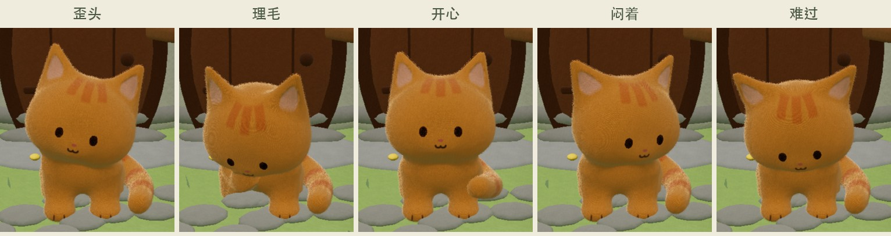
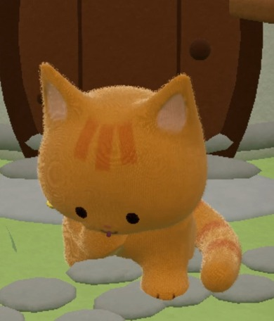
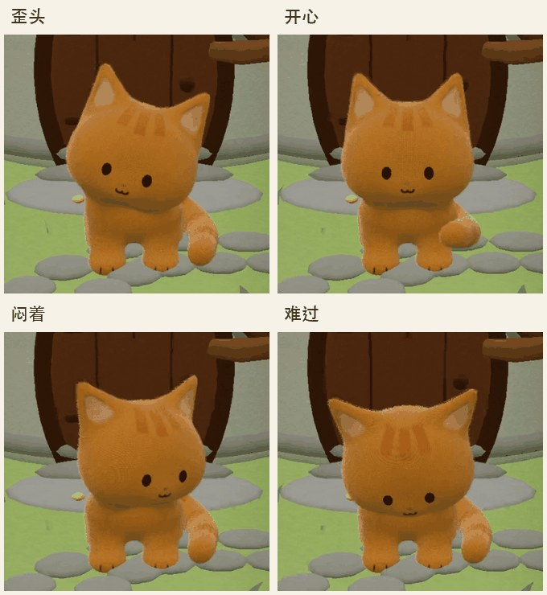
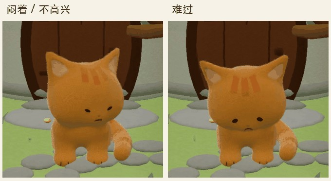

# 3D 生活动作第二批验收

2026-10-10：用户确认第一批最后一项猫窝睡姿并要求继续，按既定顺序实施第二批。当前已接入，程序检查与模拟器构建通过；理毛最终版已确认，歪头与三种情绪待逐项确认；未安装真机，未提交/推送。

## 动作与行为

- 歪头：坐稳后单侧倾头，轻微呼吸；抬头回正再站起。
- 理毛：坐下抬右前爪，低头向爪面短促舔动；另一前爪和后肢承重，退出时收舌、落爪、站稳。
- 开心：抬头、耳朵立起、尾根抬高；闷着：侧过脸、耳朵略向外；难过：低头、耳朵垂下。每组有独立进入、持续、退出片段。
- 共新增15段，总32段。已确认的17段动画逐通道采样哈希保持，角色网格/UV/权重指纹保持。正常首页复用既有 `MoodRules.housePool` 的气质/情绪权重；夜间和猫窝仍优先休息，不增加新的情绪判定规则。
- 真实持续阶段才回报安顿，理毛不再降级成静坐。状态句与聊天世界事实使用实际动作；换地点先退出，内容进程重建恢复片段与播放时间。第二批动作不写饮水事实。

## 检查与边界

全套本机检查通过：10套Swift、33项网页测试、跨端规则及前后端类型检查；最终网页、iPhone 17 Pro / iOS 26.5模拟器构建通过。真实GLB回归覆盖原基础动作、第一批喝水和猫窝、新增五组动作的进入/持续/退出、中断及各阶段恢复。地面表面最低点约-0.403mm，记录为轻微接触压入，不宣称零穿入。

理毛口部至右前爪网格最近距离约7.22–7.91mm，使用短舌伸缩补足舔动；接触按真实变形爪面顶点落入舌头椭球范围计数，4.8秒288帧中有57帧接触。该量测不能替代人眼判断自然度。未重测长期性能、能耗、旧设备；不沿用第一批或小院历史真机结论。

## 实拍

截图来自最终模拟器构建，仅裁切、缩放与排版。依次为歪头、理毛、开心、闷着、难过。近景用于查看动作，不改变日常镜头。

[运行时回归](metrics/runtime.json)、[构建与截图状态](metrics/evidence.json)。原始截图和录屏留本机。

## 同日修正：理毛舌头过亮

用户否决理毛舌头的亮点感。原舌头使用浅粉色 Standard 材质且不接收头部阴影；理毛阶段改用暗玫瑰色 `#98565d` 的 Lambert 漫反射材质（无镜面高光），接收阴影。喝水阶段继续使用原已确认材质；几何、舔动幅度、32段动画和接触位置未改。

网页类型检查、33项测试与模拟器构建通过；新版来自同版本模拟器录屏。该修正仅涉及材质，没有重复宣称新的接触或真机验收。观感待确认。

[本次构建和画面证据](metrics/tongue-matte.json)。

## 同日再次修正：舌头缩成小点

用户指出哑光版舌头太小、不像舌头，上节候选被否决。此次为理毛单独设置更细分的扁平圆舌尖，最大宽18mm、厚3.6mm，长度随舔动展开再收回；舌根沿唇线向外最多4mm，避免大半藏在嘴里。颜色为暖肉粉 `#c18172` 的 Lambert 漫反射，继续接受遮光，避免上一版阴影偏紫。喝水仍使用原几何、尺寸、朝向和材质；32段骨骼动画不变。

真实GLB定向检查：4.8秒288帧内舌头与右前爪表面接触75帧；理毛退出后喝水完整完成且只计一次。类型检查、33项网页测试、模拟器构建通过。未重测真机；新候选观感待用户确认。

[本次构建与截图证据](metrics/tongue-shape.json)。

## 舌头形状确认与饱和度微调

用户确认圆舌尖版本，仅要求颜色再饱和一点。本次只将理毛舌头颜色从 `#c18172` 调为 `#cc7164`；形状、尺寸、舔动、哑光与遮光保持。网页类型检查和模拟器构建通过；没有改动动作逻辑，不重复运行接触回归。

[最终构建与画面证据](metrics/tongue-color.json)。未装真机、未提交/推送。

## 2026-10-12：四项表情复核

倒水获用户确认后，回到第二批尚未逐项确认的歪头、开心、闷着和难过。使用当前69段模型与已安装的最终模拟器构建录制正面近景，未修改模型或动作代码。四项观感仍待用户确认；理毛舌头最终形状与饱和度已确认，不重新列为待办。

真实GLB运行时回归重新通过，覆盖五种表情进入、持续、退出、中断与恢复。该检查不替代用户观感和最新版本真机验收。

[当前运行时回归](metrics/final-runtime.json)。原始录屏 `/tmp/maomao-expressions-final/review.mov`，动图由原速12fps抽帧裁切与排版生成，录屏不入仓库。

## 2026-10-12：眼睛与嘴巴同步心情

用户否决闷着/生气仍是圆眼笑嘴。新增运行时脸部表现：闷着收窄眼睛、内眼角压低、嘴弧收平；难过眼角下垂、嘴角下弯。使用现有 sulk/sad，不新增业务情绪。其他动作保持原眼嘴，69段GLB和骨骼未改。

脸部渐变使用实际动作片段时间，进入/退出各约0.65秒；恢复与定格直接还原同一权重。嘴纹在原有贴图局部采样变形，毛毡薄壳同步；眼球在眨眼形态后、蒙皮前变形，沿用原材质光照。

全套本机检查与网页/iPhone 17 Pro模拟器构建通过，安装包资源一致；真实GLB回归新增情绪权重、恢复一致、退出归零与其他动作无表情覆盖检查，通过。第一次启动出现不可用提示，未取得该次失败事件，原因未定；随后两次启动正常，最终实拍运行记录无error且有visualReady。该项保留为首次启动复核边界，不宣称已查明原因或通过真机性能验收。

[脸部运行时回归](metrics/face-runtime.json)。最终录屏 `/tmp/maomao-face/review2.mov`，原速12fps近景动图已交付。观感待用户确认；未装真机、未提交/推送。

## 眼嘴观感确认与首页恢复复核

用户确认闷着/难过眼嘴联动版。歪头/开心保持已交付候选，尚未单独确认；不改变理毛、第四批动作及倒水的既有确认。

本轮模拟器正常启动：首帧694ms、visualReady 757ms；主动重建内容进程：首帧578ms、visualReady 598ms。闷着恢复到 sulk_idle，随后难过到 sad_idle、退出到 happy_idle，四次快照均无 failure/webFailure，画面准备状态为true。这些时间从网页初始化计，不代表点图标到显示画面的完整冷启动耗时。

原始一次不可用提示未复现，原因仍未定，不记为已修复。本轮补的是诊断缺口：此前原生超时/命令失败只设置提示，事件链可能没有对应错误；现在统一记录 unavailable 及原始错误，Debug 构建持久保存最近一次失败技术事件，重开后仍可读取。只含运行事件，不保存聊天。

人工无效命令触发的故障单列验证，用于证明错误细节可落盘，不作为正常运行失败率或性能证据。后续重启及重建验证、检查结果见[本轮摘要](metrics/face-closeout.json)。未安装真机、未提交/推送；首次异常根因与最新真机连续验收仍未闭环。

## 2026-10-13：本轮收尾

全套本机检查通过（含35项网页测试）、真实GLB运行时回归通过，网页打包与iPhone 17 Pro/iOS 26.5模拟器构建通过。最新构建已安装，包内团子/小院模型哈希与源码分发模型一致。修正运行时验证脚本注释中的TypeScript导出命令，补`--rewriteRelativeImportExtensions`；业务代码未改。

正常启动首帧933ms、visualReady 995ms；`yardReload`模拟终止回调后首帧536ms、visualReady 550ms，均为网页初始化口径。四次快照ready及surfaceReady为true，failure/webFailure为空、旧2D推进数为0，后续难过/开心到达各自idle状态。本次镜头保留浏览位置、团子位于屏外，仅计运行状态验证，不作为表情观感或逐帧画面验收，也不把回调注入当作真实杀进程。见[收尾摘要](metrics/closeout-2026-10-13.json)。

真机连接状态为不可用，本轮无法补最新真机连续运行与正式首页冷启动/锁屏/真实进程终止逐帧证据。歪头/开心仍待用户单独确认；原始偶发不可用原因仍未确定。进度清单、首页说明及索引已同步；未暂存、提交或推送。
