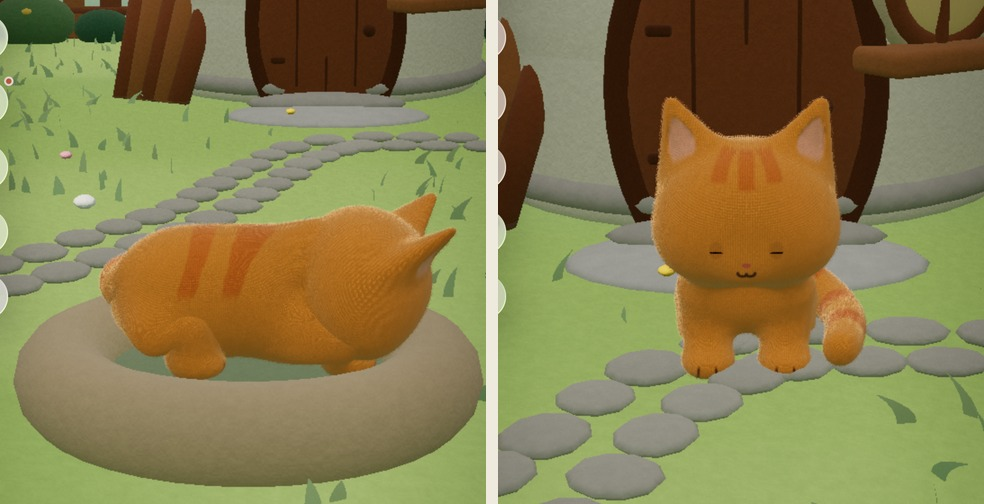
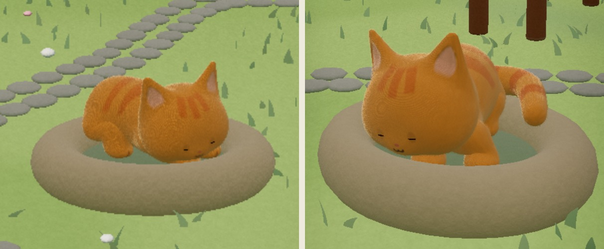

# 2026-10-10 生活动作观感修正

用户否决首版截图后的修正版；后续用户确认喝水与门口坐姿，猫窝横躺因不自然、脸不可见被否决，已单独完成新候选，猫窝最终候选已获用户确认。本轮在 iPhone 17 Pro / iOS 26.5 模拟器构建并实拍；未安装到真机，不沿用10月5日的真机结论。未提交、未推送。

## 改动

- 躺睡：收折前后腿，头落到前爪旁，身体保持平躺轮廓；进窝后先转成横向，再入睡。前肘沿身体两侧收折，保持原腿骨长度，不压入窝垫；尾巴按当前骨盆重新求解。猫窝、角色网格、UV、权重和贴图不变。
- 瞌睡：抵达门前后先转正（朝世界 +Z，即日常镜头方向），再进入专用坐下动作。臀部降低、胸部抬起、前爪移到肩下承重；缓慢点头、闭眼呼吸，起身有独立衔接。七段基础动作保留，共17段动画。
- 喝水：连续舔饮时增加轻微点头，每2.4秒末尾短停吞咽，盆口改为真实敞口，盆内出现同步扩散水纹。抬头、空盆、中断时停止水纹；仍只有整段完成才记录一次饮水。
- 验收镜头：仅带 `review` 参数的页面可用正面/侧面近景，便于检查姿势；没有改变日常首页镜头。

## 检查

- 网格/UV/权重指纹仍为 `9c3736eb4a6fb8ed5be82abe52dcfd9e435c977b08c15b81eb9f027a377008f8`；18,870三角面，GLB 1,686,744字节。
- 真实GLB运行时回归通过：门前朝向0弧度；睡稳四爪接触软垫，前爪约压入0.6mm、后爪约4.4–4.5mm，软垫全表面最大压入5.09mm；进窝、转身、睡下和离窝的窝沿穿入均为0。
- 舌尖最低43.44mm，实际水面顶47mm；有效接触288帧。完整饮水一次，五个时点中断均不记饮水。饮水三阶段、半空起落以及窝内转身阶段恢复通过。
- 烘焙片段口部上下变化：睡眠呼吸约2.13mm、瞌睡约22.31mm、舔饮/吞咽约18.53mm；不能把这些数值等同于用户观感通过。
- 全部本机检查通过：10套Swift测试、32项网页测试、仓库与跨端规则、前后端类型检查。最终恢复修正后补跑网页测试与真实GLB回归通过。模拟器构建通过。

数值：[运行时](metrics/runtime.json)、[片段](metrics/clips.json)；指纹与截图状态：[本轮证据](metrics/revision-2026-10-10.json)。

水盆的原实心顶盖挡住了水面，已仅替换水盆本体网格并同步生成脚本，其他院子物件保持。沿中央向下探测击中9mm盆底，水面实际顶高47mm；此前按45mm计算的接触数作废，现以实际水面重新测量。水盆修正增加324三角面；水纹增加两道32段圆环。验收跳转同时清除旧猫窝起落状态，避免调试传送后绕回猫窝。

## 实拍

下图是模拟器截图的裁切、缩放与排版，没有改动画画面。静态姿势在盆口修正前实拍，团子模型与最终构建完全相同；最终盆口另行重新录制喝水并核对完成回执，两次构建指纹分别保存。左为横躺，右为门前正面坐姿。

[躺睡正面](images/revision-2026-10-10/bed-front.jpg)、[躺睡侧面](images/revision-2026-10-10/bed-side.jpg)、[坐姿正面](images/revision-2026-10-10/doze-front.jpg)、[坐姿侧面](images/revision-2026-10-10/doze-side.jpg)、[喝水侧面](images/revision-2026-10-10/drink-side.jpg)。喝水短动画由本机录屏抽帧生成，原始视频/动图留本机，不入仓库。

本轮未重测长时性能、能耗或旧设备；仅增加两道水纹网格也不据此推定性能验收通过。

## 当日第二次修正：猫窝露出睡脸

用户明确确认喝水和门口坐姿，否决猫窝横躺的自然度与脸部可见性。以上首轮猫窝图片及量测保留为历史记录；当前猫窝以本节为准。

仅重新烘焙 `sleep_down`、`sleep_idle`、`sleep_up`：脊柱轻弯、前肘收向头下、头靠近前爪并朝外倾转；窝内身体朝向从90°调整为60°，正常入窝与恢复使用相同方向。其他14段动画逐通道采样数据哈希完全不变，包含已通过的喝水和门口瞌睡。网格、UV、权重指纹不变。

最终真实GLB回归：进窝、转身、睡下和离窝的窝沿穿入均为0；软垫最大压入4.63mm，睡稳前爪分别高出软垫0.26mm、压入0.11mm，后爪压入3.37–4.63mm。饮水完成/中断、基础动作及窝内恢复回归通过。10套Swift、32项网页与全部本机检查通过，最终网页和模拟器构建通过。

以下为同一最终构建的模拟器截图裁切：左侧日常首页镜头，右侧验收近景。日常镜头未修改。猫窝这版仅为待用户评审的候选，未安装真机、未重测长时性能。

[日常完整截图](images/sleep-face-2026-10-10/daily.jpg)、[近景完整截图](images/sleep-face-2026-10-10/close.jpg)、[构建、动画哈希、接触与截图状态证据](metrics/sleep-face-2026-10-10.json)。

## 用户最终确认

用户回复“这版行，继续吧”，猫窝最终候选观感通过。连同此前确认的喝水与门口坐姿，第一批三组均已确认；上文“待确认”描述的是交付时点。第二批实施与评审见[第二批报告](../tuanzi-expression-review/验收报告.md)。
