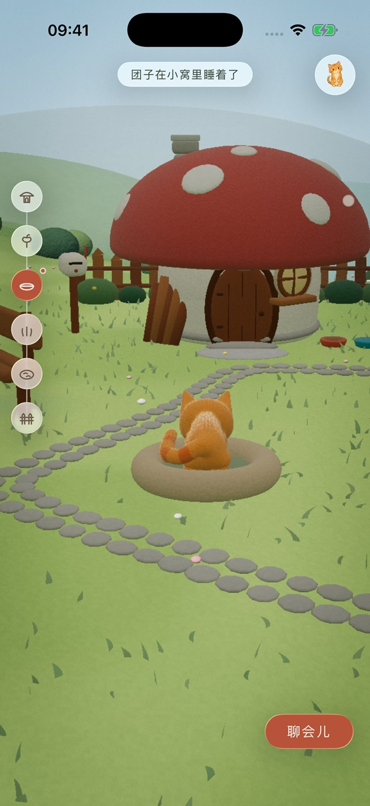
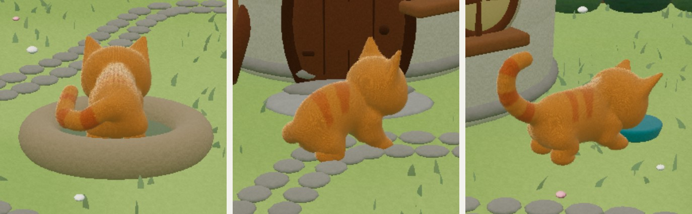

# 3D 生活动作第一批验收

当前状态：2026-10-10 用户已确认喝水、门口坐姿及最终猫窝睡姿，第一批观感通过，见[本轮记录](2026-10-10-动作修正.md#当日第二次修正猫窝露出睡脸)。下文10月5日检查与真机结果仅属于首版，不能沿用为修正版验收。未提交、未推送。

## 实现

- 沿用已确认团子的网格、UV、蒙皮、贴图，增量加入8段动作，连同原7段共15段。网格/绑定指纹前后一致，GLB约1.47MiB，18,870三角面；压缩后的可编辑blend约3.5MB，按美术源文件单独登记大文件白名单。
- 猫窝：到入口→转向→跨窝沿→趴下→闭眼呼吸；新去处先起身、离窝落地再走，半空不改路线。按尾骨真实长度避开窝沿，爪子由软垫承托。
- 门口：沿原坐下姿势进入闭眼、缓慢点头，不改变团子造型。
- 喝水：走到盆边→低头1.6秒→舔饮3轮（每轮2.4秒，含短暂停顿）→抬头1.4秒→站稳。舌尖随头部运动；只在整个周期完成后写一次饮水事实。
- 空盆、中断、过期请求不记录饮水；已完成快照不重喝。内容进程恢复保留动作阶段、循环时间和起落轨迹；后台不虚构生活进展。
- 当前动作、降级标记与原生状态句/聊天事实同步。其他地点休息及理毛仍降级，第二至四批尚未实施。

## 量测与验证

下表为10月5日历史结果；`runtime.json`、`clips.json`已随10月10日修正版更新，当前结果以本轮记录为准。首版[资源与构建指纹](metrics/build.json)保留。运行时检查加载真实导出GLB，逐帧变形后测量，不以骨骼端点代替表面。

| 检查 | 结果 |
|---|---|
| 猫窝进场、趴睡、出场的窝沿表面穿入 | 0 |
| 软垫最大接触压入 | 4.97mm，作为软垫接触单列；未把它称为零穿入 |
| 睡稳后的四爪承托 | 前爪约压入4.9mm，后爪约0.5–0.7mm；无悬空承托 |
| 舌尖最低点 / 水面顶 | 42.29mm / 45mm；有效接触192帧，径向最小距离76.85mm，在84mm水面内 |
| 完整饮水 / 五个阶段中断 | 完整一次；中断均零次 |
| 恢复 | 饮水低头、舔饮、抬头阶段和半空起落接续通过 |
| 原基础动作回归 | 直行、180°转身、90°折线、曲线滑步与切换、坐姿尾巴、抖耳通过 |
| 本机检查 | 10套Swift测试、31项网页测试、跨端规则、仓库规则、前后端类型检查通过 |
| 构建 | iPhone 17 Pro模拟器与iPhone 16 Pro Max签名构建通过 |

## 画面与设备证据

- 模拟器：进窝、睡眠、离窝、喝水以及睡眠/舔饮时重载已执行；完整饮水时间已写入本地持久化。首轮录像122.11秒、7,221帧，未检出白屏或画布露底，见[逐帧检测](metrics/simulator-video.json)。该录像是修复恢复后残留坐下意图之前的候选，不能冒充最终候选的逐帧证据。
- 最终候选：源码 `e3f472aa81041f1bd17a98f365a67ed94e99b0e06980b5b558c7b8a972f88177`，团子GLB `a3ff61d036a3d95ec66a6314bc250b21b78003b3b4d217bfdf8f18bf9a7195c4`。
- 真机：同版本已安装并启动，猫窝睡眠及恢复、门口瞌睡已有实际状态回执。固定延时喝水未构成有效验证：发指令时仍在返程，且设备中途切出App，记录为未通过测试条件，不写“喝水通过”。见[首轮真机状态](metrics/device-first-pass.json)。用户保持前台后补跑有效轮次：`drink_lap → 重载后drink_lap → drink_up → idle`，完成计数从1到2，只增一次；`drinkDone/settled`为true、原生饮水时间存在，见[真机喝水复核](metrics/device-verified-drink.json)。远程截图返回纯黑，未作为画面证据；不据此宣称真机视觉已通过。
- 只保留本App的量测和压缩图；原始录像/截图留在本机。最终动作好不好看仍需用户确认，不将程序通过等同于美术通过。

## 边界

没有重做已确认造型；未重启2D素材线。本批没有20分钟性能、能耗、旧设备适配或完整真机逐帧结论，不沿用第1项的成绩。第2项用户已确认的手势/入口验收仍有效，但不能替代本批新动作的观感确认。

## 2026-10-10 实际截图供观感评审

按用户要求重新启动已安装的同版本模拟器，分别截取 `sleep_idle`、`doze_idle`、`drink_lap`，状态回执核对一致。下图仅对真实截图裁切放大，从左到右为趴睡、瞌睡、喝水；当前镜头偏背面，静态截图不能证明动态观感。该次截图时未改动作代码；用户随后要求返工，见10月10日修正记录。

完整画面：[趴睡](images/preview-2026-10-10/bed.jpg)、[瞌睡](images/preview-2026-10-10/doze.jpg)、[喝水](images/preview-2026-10-10/drink.jpg)。[截图指纹与动作状态](metrics/preview-2026-10-10.json)。
