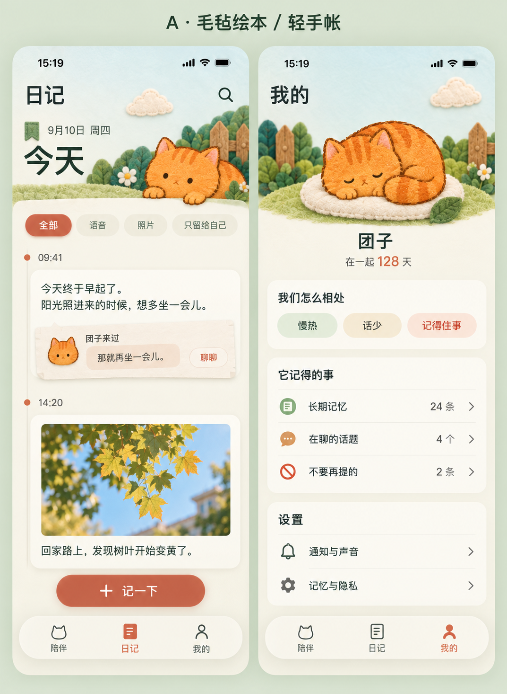
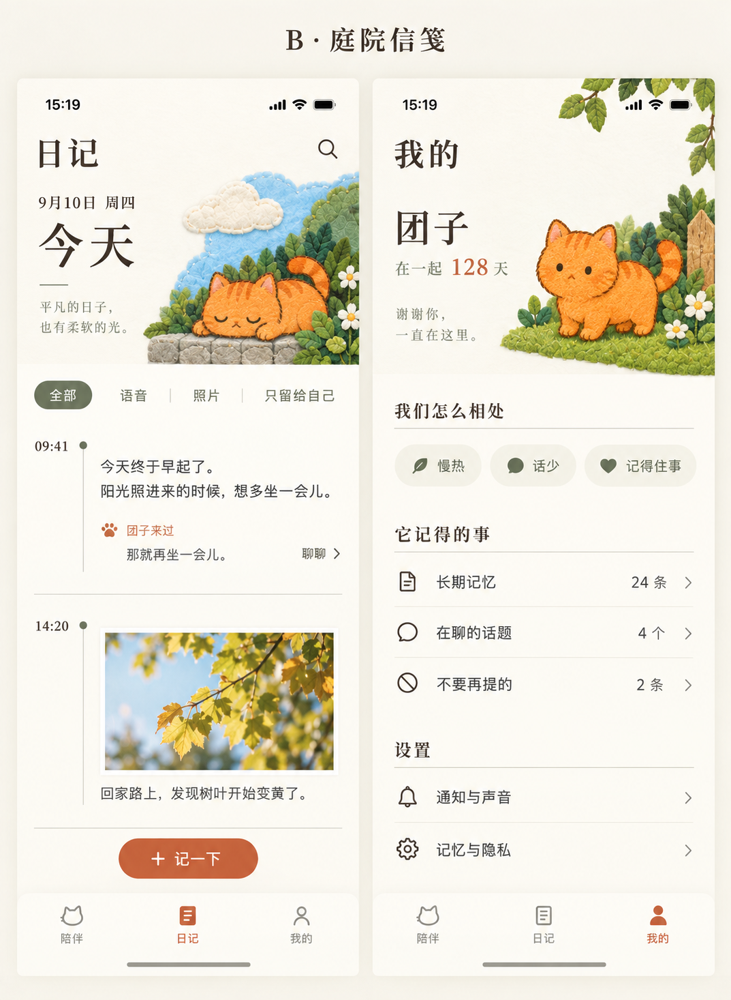
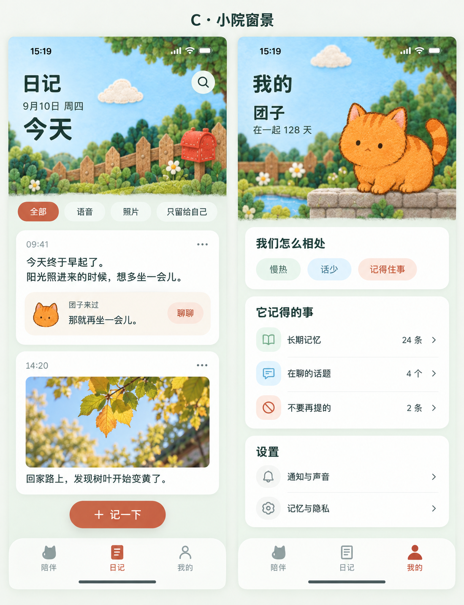

# 日记与我的 · 三版 UI 示例

日期：2026-09-10。使用内置 image_gen 生成；仅风格候选，未改 App。每张左侧日记、右侧我的。

## 参考
/Users/gouzi/猫猫的app/outputs/world-v3/review/final-motion/frame-033.00.png
/Users/gouzi/猫猫的app/assets/tuanzi/felt-world-pack-v1/character/02-single-cat-material-preview.png

## A-毛毡绘本-轻手帐

### 实际提示词

Use case: ui-mockup. Produce a high-fidelity DESIGN EXPLORATION BOARD for an existing Chinese iOS cat companion app. Two complete flat app screens SIDE BY SIDE, left Diary and right My page, each with an approximately 390:844 portrait ratio, both same size, full safe areas and bottom navigation visible. Overall canvas portrait-ish 1200x1400 or similar fitting two tall screens. Large readable Chinese UI, refined spacing. No perspective, device hardware, hands, decorative desk props or watermark. Put only a compact variant heading OUTSIDE screens at the top. Reference image 1 establishes the existing felt courtyard world (stitched clouds, blue pond, greenery, warm wood); reference image 2 is the EXACT cat identity: orange round squat cat, three forehead stripes, black dot eyes, tiny discreet brown mouth, rounded striped tail, light felt texture, no white belly or chest. Keep cat identity, make context-appropriate poses. These references guide subject/style, not the screen layout. Design two NEW UI screens, do not reproduce the reference home screen. Chinese text must be legible and exact. Same content and bottom bar across both screens:
Diary top: '日记', '9月10日 周四', large '今天'; search small icon; filters '全部' '语音' '照片' '只留给自己'. Two entries: time '09:41', body '今天终于早起了。\n阳光照进来的时候，想多坐一会儿。'; cat note '团子来过' and '那就再坐一会儿。' with small '聊聊'; second time '14:20', a small photo of sunny leaves and caption '回家路上，发现树叶开始变黄了。'. Main action '+ 记一下'. My screen: top '我的', cat hero with '团子', '在一起 128 天'; section '我们怎么相处', tags '慢热' '话少' '记得住事'; section '它记得的事', compact rows '长期记忆' '24 条', '在聊的话题' '4 个', '不要再提的' '2 条'; section '设置', '通知与声音' and '记忆与隐私'. BOTH screens bottom nav icons and labels '陪伴' '日记' '我的'; active diary on left, active my on right. Keep nav components identical, small coral #C25A3E active tint. Body type clean PingFang-like sans serif 15-16pt, generous contrast, no text laid on busy texture. NO stats dashboards, game currency, badges, hearts, growth meters or decorative nonsense. Make hierarchy and information density realistic for an actual app.
Variant heading: 'A · 毛毡绘本 / 轻手帐'. Direction: tender tactile felt storybook meets restrained contemporary journal. Warm sage #DCE5D3 background, milk #FAF8F0 content, deep forest #354435 ink, light honey and existing coral accent. Distinctive signature: a small softly stitched sage BOOKMARK on date header and one subtle paper overlap for cat reply. Very light textile details only at periphery and tiny icons, NOT woolly letters or rough reading surfaces. Diary content sits on clean rounded cream paper shapes with gently offset tiny cat reply slip. Avoid excessive tape, stitches or paw prints; no notebook binder rings. Right hero cat curled on a small felt cream cushion with one felt leaf at edge, name beneath, calm low relief. Grouped settings with generous whitespace, smooth warm-white surfaces. Main controls subtle frosted, readable. Sophisticated cozy app, beautiful and genuinely native. Two complete crisp screens.

## B-庭院信笺

### 实际提示词

Use case: ui-mockup. Produce a high-fidelity DESIGN EXPLORATION BOARD for an existing Chinese iOS cat companion app. Two complete flat app screens SIDE BY SIDE, left Diary and right My page, each with an approximately 390:844 portrait ratio, both same size, full safe areas and bottom navigation visible. Overall canvas portrait-ish 1200x1400 or similar fitting two tall screens. Large readable Chinese UI, refined spacing. No perspective, device hardware, hands, decorative desk props or watermark. Put only a compact variant heading OUTSIDE screens at the top. Reference image 1 establishes the existing felt courtyard world (stitched clouds, blue pond, greenery, warm wood); reference image 2 is the EXACT cat identity: orange round squat cat, three forehead stripes, black dot eyes, tiny discreet brown mouth, rounded striped tail, light felt texture, no white belly or chest. Keep cat identity, make context-appropriate poses. These references guide subject/style, not the screen layout. Design two NEW UI screens, do not reproduce the reference home screen. Chinese text must be legible and exact. Same content and bottom bar across both screens:
Diary top: '日记', '9月10日 周四', large '今天'; search small icon; filters '全部' '语音' '照片' '只留给自己'. Two entries: time '09:41', body '今天终于早起了。\n阳光照进来的时候，想多坐一会儿。'; cat note '团子来过' and '那就再坐一会儿。' with small '聊聊'; second time '14:20', a small photo of sunny leaves and caption '回家路上，发现树叶开始变黄了。'. Main action '+ 记一下'. My screen: top '我的', cat hero with '团子', '在一起 128 天'; section '我们怎么相处', tags '慢热' '话少' '记得住事'; section '它记得的事', compact rows '长期记忆' '24 条', '在聊的话题' '4 个', '不要再提的' '2 条'; section '设置', '通知与声音' and '记忆与隐私'. BOTH screens bottom nav icons and labels '陪伴' '日记' '我的'; active diary on left, active my on right. Keep nav components identical, small coral #C25A3E active tint. Body type clean PingFang-like sans serif 15-16pt, generous contrast, no text laid on busy texture. NO stats dashboards, game currency, badges, hearts, growth meters or decorative nonsense. Make hierarchy and information density realistic for an actual app.
Variant heading: 'B · 庭院信笺'. Direction: calm intimate garden correspondence, editorial reading journal, aesthetically mature, airy, restrained. Oat paper #F5F2E9 background, ivory #FFFEF9 sheet, moss #65745D, warm brown #493F34; coral only small main action/active nav. STRUCTURALLY DIFFERENT: Diary is one continuous open reading page with clearly spaced dated entries and fine quiet separators, NOT stacked rounded cards. Dates and title use restrained Chinese Songti, body clean sans. Cat reply indented as a marginal annotation with tiny cat paw, no chat bubble. Small rectangular photograph inset with white paper margin. My page composed like a personal relationship keepsake: cat small in upper right of a tranquil masthead, '团子' and time together left; one small original felt garden sprig in header margin to connect world. Below, editorial section labels and unboxed aligned rows, generous whitespace, hairlines. No fake torn paper, heavy grain, vintage stamps, tape or dashboard tiles. Subtle floated nav same across screens. Feels like quietly opening a letter from the courtyard. All supplied content remains visible and readable.

## C-小院窗景

### 实际提示词

Use case: ui-mockup. Produce a high-fidelity DESIGN EXPLORATION BOARD for an existing Chinese iOS cat companion app. Two complete flat app screens SIDE BY SIDE, left Diary and right My page, each with an approximately 390:844 portrait ratio, both same size, full safe areas and bottom navigation visible. Overall canvas portrait-ish 1200x1400 or similar fitting two tall screens. Large readable Chinese UI, refined spacing. No perspective, device hardware, hands, decorative desk props or watermark. Put only a compact variant heading OUTSIDE screens at the top. Reference image 1 establishes the existing felt courtyard world (stitched clouds, blue pond, greenery, warm wood); reference image 2 is the EXACT cat identity: orange round squat cat, three forehead stripes, black dot eyes, tiny discreet brown mouth, rounded striped tail, light felt texture, no white belly or chest. Keep cat identity, make context-appropriate poses. These references guide subject/style, not the screen layout. Design two NEW UI screens, do not reproduce the reference home screen. Chinese text must be legible and exact. Same content and bottom bar across both screens:
Diary top: '日记', '9月10日 周四', large '今天'; search small icon; filters '全部' '语音' '照片' '只留给自己'. Two entries: time '09:41', body '今天终于早起了。\n阳光照进来的时候，想多坐一会儿。'; cat note '团子来过' and '那就再坐一会儿。' with small '聊聊'; second time '14:20', a small photo of sunny leaves and caption '回家路上，发现树叶开始变黄了。'. Main action '+ 记一下'. My screen: top '我的', cat hero with '团子', '在一起 128 天'; section '我们怎么相处', tags '慢热' '话少' '记得住事'; section '它记得的事', compact rows '长期记忆' '24 条', '在聊的话题' '4 个', '不要再提的' '2 条'; section '设置', '通知与声音' and '记忆与隐私'. BOTH screens bottom nav icons and labels '陪伴' '日记' '我的'; active diary on left, active my on right. Keep nav components identical, small coral #C25A3E active tint. Body type clean PingFang-like sans serif 15-16pt, generous contrast, no text laid on busy texture. NO stats dashboards, game currency, badges, hearts, growth meters or decorative nonsense. Make hierarchy and information density realistic for an actual app.
Variant heading: 'C · 小院窗景'. Direction: luminous modern app with a view into the existing felt courtyard. STRUCTURALLY DISTINCT: upper quarter of each screen is a beautifully cropped felt garden scene, muted blue sky, soft foliage and distant wood fence; fades smoothly into mist sage #E8EEE7 lower page. Cat only prominently in right header, sitting on a low felt ledge, using exact reference identity. Main content clean smooth white #FFFFFF cards, 20pt corners, subtle soft shadow, deep green #253C32 body, sparing coral accents, pond blue secondary detail. Diary header date/title readable over quiet pale sky, no text on detailed leaves; short neat filters below transition; cards and response both opaque readable. My header has '团子' and together time within quiet scene margin, below modular crisp list groups. Small translucent liquid-glass search and nav controls ONLY, do not make reading cards transparent. Modern iOS-native clarity with handmade garden inside the window, no 3D clay/plastic cats, no metallic shine or giant glass cards. Very high polish; real app content fits, not merely a decorative splash screen.