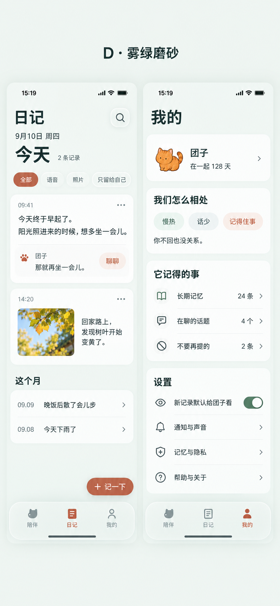
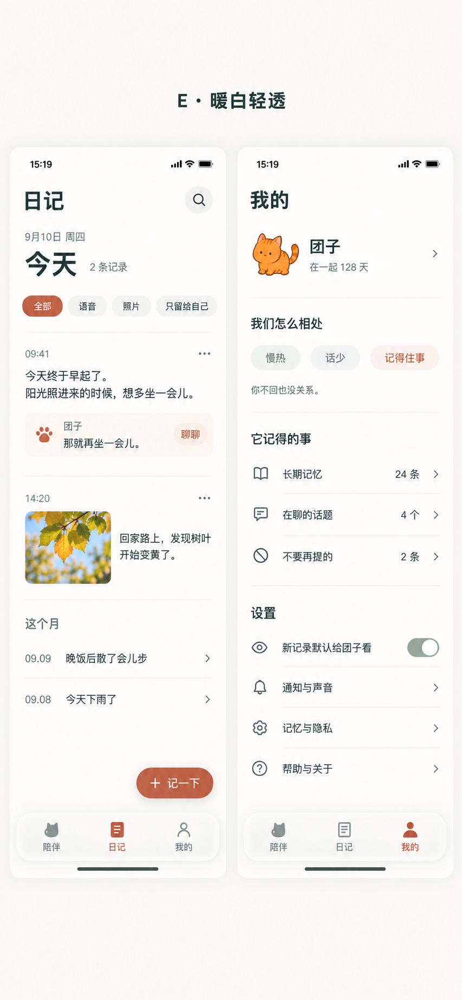

# 简约纯净 UI · 第二轮

用户新要求：设计克制，允许少量元素，不要大篇幅插画；整体简约纯净，尝试毛玻璃增加质感。

使用内置 image_gen；D 雾绿磨砂、E 暖白轻透。均为静态候选，未改 App。图中比例、字体和角色细节仍需落地校准。

## 参考图
/Users/gouzi/猫猫的app/outputs/ui-style-examples-2026-09-10/C-小院窗景.png
/Users/gouzi/猫猫的app/assets/tuanzi/felt-world-pack-v1/character/02-single-cat-material-preview.png

## D-雾绿磨砂

### 实际提示词

Use case: ui-mockup. Redesign the supplied app mockup into a radically more RESTRAINED, MINIMAL, PURE, sophisticated Chinese iOS cat companion app. User rejected large illustrations. Reference 1 is ONLY the previous app content and concept to revise: REMOVE ALL its landscape headers, garden panoramas, foliage, fences, clouds and large cats. Reference 2 is ONLY exact identity for ONE tiny cat avatar. Preserve orange squat cat, black dot eyes, three forehead stripes, striped tail, subtle felt identity. Not a new character. Output a polished presentation board with TWO full 390x844-like portrait flat screen artboards side-by-side, left diary and right my profile, equal scale, straight-on, complete top status and bottom navigation. No phone hardware, no perspective, no decor outside screen, no explanatory marketing paragraphs. Board heading compact outside UI. Generous deliberate whitespace, optical alignment, immaculate typography, dark readable 15-16pt PingFang-style Chinese body. Hierarchy through spacing rather than lots of nested cards. CONTENT fills around 65% of screen leaving real breathing room, no giant vacant hero.
CRITICAL VISUAL LIMIT: no landscape illustrations anywhere. Only ONE 48-56pt cat avatar on profile near name, and optionally a 16pt paw mark in diary reply. Cat/illustrations less than 2% of each screen. Absolutely no large cat sitting, big cat heads, flowers, grass, plants, toy scenes, stitched edges, torn paper, scattered particles, cute stickers. Brand coherence comes from subtle garden sage undertones and orange cat avatar.
Materials: genuine restrained frosted glass for bottom navigation and a small top search control, with realistic softly blurred color showing through, extremely fine white edge highlight, subtle contact shadow. No glass glare, bevels, inflated plastic/neumorphism, chrome, prisms, 3D typography, thick double borders. Main reading content smooth nearly opaque white/ivory, readable. Background an almost flat neutral wash, subtle broad tone variations only, no obvious blobs, no shapes under glass. Deep green/charcoal text; a single desaturated terracotta accent used sparingly. Icons thin rounded line, monochrome, identical visual weight; NO colored icon tiles.
Diary: top status, compact title '日记' left and small search right; margin-top smaller date '9月10日 周四', 28pt '今天', small count '2 条记录' inline. One quiet filter strip '全部' '语音' '照片' '只留给自己', selected label darker with minimal pill. First record time '09:41', text '今天终于早起了。\n阳光照进来的时候，想多坐一会儿。'. Reply unobtrusive indented row with tiny paw: '团子' and '那就再坐一会儿。', tiny '聊聊'. Second time '14:20', compact real photograph thumbnail of sunlit yellow leaves no larger than 110x76pt NEXT TO text '回家路上，发现树叶开始变黄了。', avoid dominant full-width image. Small month section '这个月', two tidy rows '09.09  晚饭后散了会儿步' and '09.08  今天下雨了'. Small '+ 记一下' action aligned right above nav, no oversized full-width CTA.
My: title '我的'. Compact horizontal profile row tiny exact cat avatar at left, '团子', '在一起 128 天' at right, profile block max 90pt high. Section '我们怎么相处', plain quiet tags '慢热' '话少' '记得住事', short supporting line '你不回也没关系。'. Section '它记得的事': three aligned compact rows '长期记忆' + '24 条'; '在聊的话题' + '4 个'; '不要再提的' + '2 条'. Section '设置': rows '新记录默认给团子看' with small sage toggle, '通知与声音', '记忆与隐私', '帮助与关于'. Right chevrons tiny where useful. No engagement metrics or gamification.
Both screens share exactly the same small floating frosted bottom nav with 3 icons and labels '陪伴' '日记' '我的'; left active diary, right active my; small muted terracotta selected icon+label, no large accent block. Three-part nav contained in restrained single capsule with safe area. All text readable and exact. Render actual exceptionally polished app UI, NOT an ornamental poster.
Heading 'D · 雾绿磨砂'. Cool-clean direction, pale grey sage #EDF2EF background, main white #FBFDFC panels, forest-charcoal #293C34 type, subdued terracotta #B66D55 accent. A very faint sage light wash near top and bottom gives translucent controls some depth. Diary uses TWO clean shallow rounded content groups (18pt radii), reply inside first card separated by spacing, no nested bubble. Profile grouping uses subtle nearly white panels, all monochrome line icons. Moderate quiet glass effect on nav and search, faint white top edge. Clean sans throughout, titles semibold 28pt. Quiet premium native design, almost no illustration. Keep screenshot surfaces soft but crisp, NO wool or noisy grain.

## E-暖白轻透

### 实际提示词

Use case: ui-mockup. Redesign the supplied app mockup into a radically more RESTRAINED, MINIMAL, PURE, sophisticated Chinese iOS cat companion app. User rejected large illustrations. Reference 1 is ONLY the previous app content and concept to revise: REMOVE ALL its landscape headers, garden panoramas, foliage, fences, clouds and large cats. Reference 2 is ONLY exact identity for ONE tiny cat avatar. Preserve orange squat cat, black dot eyes, three forehead stripes, striped tail, subtle felt identity. Not a new character. Output a polished presentation board with TWO full 390x844-like portrait flat screen artboards side-by-side, left diary and right my profile, equal scale, straight-on, complete top status and bottom navigation. No phone hardware, no perspective, no decor outside screen, no explanatory marketing paragraphs. Board heading compact outside UI. Generous deliberate whitespace, optical alignment, immaculate typography, dark readable 15-16pt PingFang-style Chinese body. Hierarchy through spacing rather than lots of nested cards. CONTENT fills around 65% of screen leaving real breathing room, no giant vacant hero.
CRITICAL VISUAL LIMIT: no landscape illustrations anywhere. Only ONE 48-56pt cat avatar on profile near name, and optionally a 16pt paw mark in diary reply. Cat/illustrations less than 2% of each screen. Absolutely no large cat sitting, big cat heads, flowers, grass, plants, toy scenes, stitched edges, torn paper, scattered particles, cute stickers. Brand coherence comes from subtle garden sage undertones and orange cat avatar.
Materials: genuine restrained frosted glass for bottom navigation and a small top search control, with realistic softly blurred color showing through, extremely fine white edge highlight, subtle contact shadow. No glass glare, bevels, inflated plastic/neumorphism, chrome, prisms, 3D typography, thick double borders. Main reading content smooth nearly opaque white/ivory, readable. Background an almost flat neutral wash, subtle broad tone variations only, no obvious blobs, no shapes under glass. Deep green/charcoal text; a single desaturated terracotta accent used sparingly. Icons thin rounded line, monochrome, identical visual weight; NO colored icon tiles.
Diary: top status, compact title '日记' left and small search right; margin-top smaller date '9月10日 周四', 28pt '今天', small count '2 条记录' inline. One quiet filter strip '全部' '语音' '照片' '只留给自己', selected label darker with minimal pill. First record time '09:41', text '今天终于早起了。\n阳光照进来的时候，想多坐一会儿。'. Reply unobtrusive indented row with tiny paw: '团子' and '那就再坐一会儿。', tiny '聊聊'. Second time '14:20', compact real photograph thumbnail of sunlit yellow leaves no larger than 110x76pt NEXT TO text '回家路上，发现树叶开始变黄了。', avoid dominant full-width image. Small month section '这个月', two tidy rows '09.09  晚饭后散了会儿步' and '09.08  今天下雨了'. Small '+ 记一下' action aligned right above nav, no oversized full-width CTA.
My: title '我的'. Compact horizontal profile row tiny exact cat avatar at left, '团子', '在一起 128 天' at right, profile block max 90pt high. Section '我们怎么相处', plain quiet tags '慢热' '话少' '记得住事', short supporting line '你不回也没关系。'. Section '它记得的事': three aligned compact rows '长期记忆' + '24 条'; '在聊的话题' + '4 个'; '不要再提的' + '2 条'. Section '设置': rows '新记录默认给团子看' with small sage toggle, '通知与声音', '记忆与隐私', '帮助与关于'. Right chevrons tiny where useful. No engagement metrics or gamification.
Both screens share exactly the same small floating frosted bottom nav with 3 icons and labels '陪伴' '日记' '我的'; left active diary, right active my; small muted terracotta selected icon+label, no large accent block. Three-part nav contained in restrained single capsule with safe area. All text readable and exact. Render actual exceptionally polished app UI, NOT an ornamental poster.
Heading 'E · 暖白轻透'. Warm-pure direction: near-white #F8F7F3 background, neutral ivory #FEFDFC, warm graphite #353B35, sage-grey #87978B, very restrained terracotta #B66D55. Structure DIFFERENT from D: a continuous reading surface, diary entries mostly UNBOXED with fine pale dividers; no stack of rounded cards. Dates in clean small type, section titles slightly lighter refined 26pt sans. Profile rows also mostly unboxed beneath quiet section labels; large internal vertical spacing, hairline separators. Only selected filter, search, and bottom nav use light frosted translucent surfaces. Tiny profile cat is sole orange illustration, absolutely no paper texture, no decorative branches or editorial serif oversizing. Glass nav gets an almost imperceptible warm-sage blurred backdrop. Premium clarity through alignment, refined proportions and calm white space, not decorative texture.