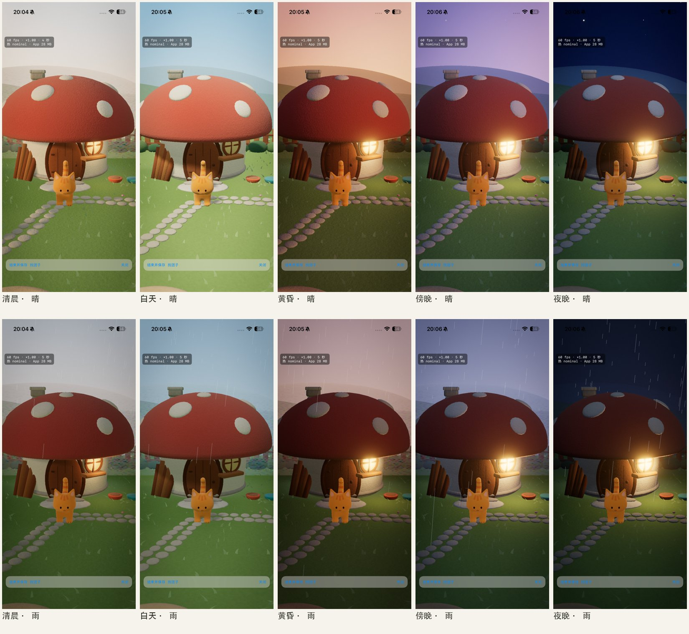
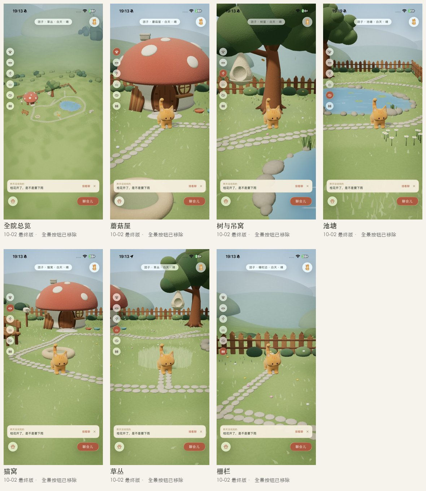
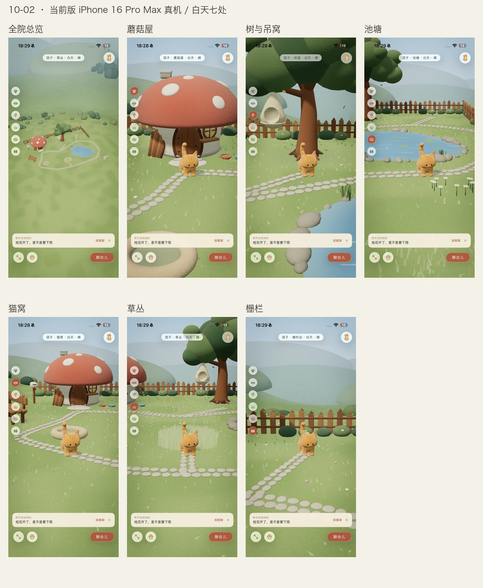
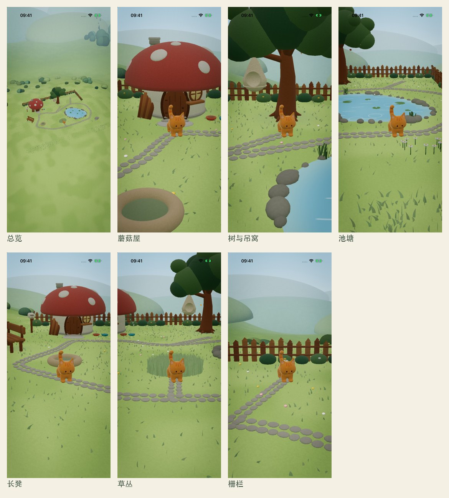

# 3D 小院空间、细节与收尾验收（更新至 2026-10-02）

**当前状态：第1项“小院定稿与性能收尾”已完成，锁定最终调试基线2525…aa27。用户画面/手感确认、一键全景按钮移除、三组20分钟持续性能、真实恢复与正常录像、双进程内存观测窗口、有效拔线能耗、五时段晴雨光色快检及本机检查/构建均闭环。结论限iPhone16ProMax/iOS26.6.2；正式首页仍2D，后续接入另轮推进。未提交/推送。**

## 最终锁定与适用范围

[最终收尾汇总](metrics/iphone16pm-2026-10-02/closeout-final.json)汇集同版本证据及适用范围；各组原始记录保留独立判定。

- 源码哈希：`2525cebfa7b8108d97f07bed599be98f3d3249fe29734b6cb66aace8d3ccaa27`；构建对应未提交工作树，不能只用HEAD标识这份实现。
- 院子模型：`cba16d2a9b14d4877511c96ce52a9b793a1d3439aae23b9e33d887fe7b39478f`；团子模型：`06cf68b349dc1b8be7358d7bbbc72e2e02083aa345146e3f8537617fa8409cdb`；布局`open-yard-v3`。
- 配置：×1.5、MSAA关、目标60fps、完整后处理/辉光、2048阴影、完整草量、四层绒毛。取消左下全景按钮，双指缩放、找团子及内部总览取景能力保留。
- 适用范围：本台真机与当前调试入口；iPhone17Pro模拟器只补较窄构图。普通图标首页仍2D，工具冷启动的3D调试结果不代表正式首页已迁移。
- 内存为夜雨与两次完整往返的同步观测窗口，不声称所有时刻/无限运行峰值；能耗为整机短窗估计，不是App单独耗电或全天续航结论。室温无温度计读数，按已提示的普通室内条件执行。

## 最终拔线能耗与五时段快检

独立夜雨漫游能耗使用Blank + Power Profiler，15秒名义时限，实际trace17.116秒，有效16个样本、15.973秒。整机耗电率估计中位**11.66%/小时**、时长加权平均12.97%/小时，范围11.23–23.26%/小时。原方案没有数值上限，只判有效记录完成；不拿不同场景/亮度的旧版数据作严格A/B，也不混入无分析器的三组性能。

仪器有效区间完整落在同次90秒原生夜雨运行内，原生全程unplugged、低电量关闭、热状态nominal，无暂停或运行错误。原生亮度约60%，Profiler返回62%，两种原值均保留。DeviceChargingState表无行，未声称仪器提供ChargingStatus=0；未充电由用户拔线确认及同次原生环境序列核对。

五时段×晴雨共10组同版本真机光色快检：启动与参数/源码/模型哈希核对后取图，先验图像非黑屏再人工浏览。清晨→白天→黄昏→傍晚→夜晚色调梯度可辨，雨天降亮及雨线正常，屋和团子可辨，未见硬矩形阴影或场景漏渲。使用实测页，图片上的测试控件不作为正式首页设计；每组10秒原始记录保持“缺测”的独立探针状态，不用短窗帧率替代正式矩阵。

[最终能耗记录](metrics/iphone16pm-2026-10-02/energy-final.json) · [能耗原生上下文](metrics/iphone16pm-2026-10-02/energy-native-final.json) · [五时段图片来源](metrics/iphone16pm-atmosphere-final-2026-10-02/picture-manifest.json) · [光色快检判定](metrics/iphone16pm-atmosphere-final-2026-10-02/visual-verdict.json)。

## 2026-10-02 最终版本持续矩阵

最终候选源码为2525…aa27，模型与完整画质参数沿用已确认配置；用户已拔线，原生全程亮度约60%、低电量关闭、热状态fair。无录像与主动分析器采样；此前内存采样已结束，Mac端保存完成后未再运行采样。室温按已提示的普通室内条件执行，无温度计读数。

| 正式组 | 有效秒 | 中位fps | 最慢1% fps | 最低倍率 | 热状态 | 结果 |
|---|---:|---:|---:|---:|---|---|
| 屋前白天固定机位 | 300.574 | 58.8 | 41.7 | 0.95 | fair | 通过 |
| 总览白天漫游 | 300.974 | 58.8 | 50.0 | 1.00 | fair | 通过 |
| 总览夜雨漫游 | 600.384 | 58.8 | 52.6 | 1.00 | fair | 通过 |

有效时间合计1201.932秒；三组均无暂停、运行错误、进程/上下文丢失、轨迹穿透，两个漫游组覆盖完整路线与六处停留点。逐组百分位独立，不平均百分位，也不以初始3813候选替代最终版。结论覆盖本台iPhone16ProMax/iOS26.6.2，模拟器只作构图复核。

[最终矩阵汇总与原始记录](metrics/iphone16pm-2026-10-02/final-performance/summary.json)。能耗与五时段晴雨光色快检另列，均已完成。

## 2026-10-02 最终候选正常操作与图像复核

用户确认拖动/缩放与切地点、10次回桌面返回（一次后台30秒）、锁屏解锁、减弱动态效果测试及还原均完成且无异常，并保存量测。保存记录源为2525…aa27，触摸1,411个样本，最大帧延迟1、最大耗时18ms，运行错误/进程丢失为0。该份记录仅包含4次暂停、最长1.912秒，不能独立证明全部10次与30秒；人工场景完成按用户确认登记，保留采样覆盖边界。

正常USB录像542.364秒、32,026帧，白屏与纯色闪空均0；抽查锁屏采集黑段、交互与菜单保存片段，锁屏黑段不当作运行期白屏。冷启动录像逐0.2秒抽查：4.6–4.8秒开始系统启动过渡，5.0–5.2秒出现3D，5.2–5.4秒完成揭幕；保守启动到首图上界0.6秒、稳定0.8秒。该结论覆盖App关闭后工具启动3D调试入口；普通图标仍进入2D首页，不代表正式3D首页启动验收。

最终版交互前USB内存11个同步样本峰值267.92MiB；总览夜雨31秒窗口31个同步样本峰值273.99MiB，均为App与WebContent同一时刻合计，低于450MiB。后台往返已由用户补做并保存：同次运行原生量测记录3次暂停，分别23.258/25.099/63.869秒，恢复无错误。对应121.051秒内存窗口已导出83个同步样本，App与WebContent合计峰值274.17MiB，低于450MiB；14个后台样本，时间对齐覆盖前两次完整往返。第三次63.869秒超出内存窗口，不纳入合计峰值；已测夜雨/往返窗口过线，适用范围明确保留。分析器结束后符号解析与保存较慢，不把保存等待计入采样。用户已确认拔线，原生亮度约60%、低电量关闭、热状态fair；最终持续矩阵与独立能耗均已完成，见上方最终章节。

最终版七处白天与三处夜雨截图均已取回，先核源码/模型哈希、入镜/遮挡与体积再看图；10张全部团子完整入镜、控件重叠0，左下仅保留找团子。池塘白天首次取回黑截图，保留原图后重拍，重拍内容通过人工复核；成功的参数JSON不能替代成功图像。iPhone17Pro较窄模拟器屋前/总览也已补验，未作模拟器性能结论。

证据：[后台往返同步内存](metrics/iphone16pm-2026-10-02/memory-final-return-window.json)、[补做往返原生状态](metrics/iphone16pm-2026-10-02/memory-return-manual-final.json)、[较窄最终版取景](metrics/iphone17pro-cover-final-2026-10-02/picture-manifest.json)、[正常操作量测](metrics/iphone16pm-2026-10-02/normal-interaction-final.json)、[正常操作判定与边界](metrics/iphone16pm-2026-10-02/normal-interaction-verdict.json)、[正常录像判定](metrics/iphone16pm-2026-10-02/normal-interaction-video-analysis.json)、[工具冷启动判定](metrics/iphone16pm-2026-10-02/cover-fix/cold-launch-verdict.json)、[最终夜雨内存](metrics/iphone16pm-2026-10-02/memory-final-night-window.json)、[最终版图像来源](metrics/iphone16pm-final-2026-10-02/picture-manifest.json)。

## 2026-10-02 USB补验与用户反馈

用户明确回复画面和操作均无问题，但取消“一键缩放按钮”，对应左下角“全景”控件；双指缩放、找团子和内部全院取景能力保留，见[当日决定第3条](../../docs/决策/2026-10-02.md)。已移除按钮，并通过真机/模拟器构建、较窄模拟器取景和本机全检查。按钮移除候选哈希 `baca2af466249c60882ef22b15b1bc7d2319bec4eed10cfe160e435b0dd80661` 的夜雨USB稳定窗口取11个同步样本，App与WebContent合计峰值 **275.99MiB**，低于450MiB；最终版往返内存另列上方，不把该旧候选窗口当全部内存覆盖。

USB QuickTime初次出现黑预览与无法录制，重建输入并采用最佳质量后取得有效录像。17.202秒夜雨录像977帧无闪空/白屏；随后真实内容进程SIGKILL录像出现2帧纯色底（0.05秒），逐帧确认是恢复遮罩也被0.16秒淡入动画驱动，先露出WebKit底色，再出现原生渐变天空。正常画面与用户手势确认不受这轮故障数据替代。

修复仅将遮罩改为立即覆盖，新画面准备好后仍淡出。最终候选源码哈希 **`2525cebfa7b8108d97f07bed599be98f3d3249fe29734b6cb66aace8d3ccaa27`**，模型与画质未变。修复后真实SIGKILL三次：visualReady恢复分别0.569/0.486/0.475秒，猫位置与镜头参数一致；110.543秒USB录像6208帧，自动检测纯色闪空0、白屏0。原生渐变天空用于恢复等待，不误计为露底；故障轮正常运行判定全部保持“未通过”。

证据：[夜雨USB内存](metrics/iphone16pm-2026-10-02/memory-usb-night-final.json)、[修复前录像判定](metrics/iphone16pm-2026-10-02/usb-start-demo-recovery-analysis.json)、[三次真实恢复状态](metrics/iphone16pm-2026-10-02/cover-fix/state-verdict.json)、[修复后录像判定](metrics/iphone16pm-2026-10-02/cover-fix/video-analysis.json)。原始录像只留本机。正常操作结果见上方最终候选补验；冷启动采用进程关闭后的工具启动3D调试入口，普通图标打开仍为2D，不用它替代3D冷启动证据。正式首页迁移仍未启动。

## 2026-10-02 初始候选真机收尾（历史结果，最终结论以上方为准）

用户已要求开始执行[收尾计划](../../docs/方案/3D小院定稿与性能收尾-方案-2026-10-02.md)，并打开受信任的测试 App。设备为 iPhone 16 Pro Max（iPhone17,2），iOS 26.6.2；当前签名构建与模拟器构建均通过。测试通过无线连接取回原始证据，手机未充电，低电量模式关闭，亮度约60%（屋前诊断组约55%），三组全程热状态 nominal；桌面3D与模拟器均关闭。室温仍待人工补充。

本轮没有改动画面或降级效果。仅增加原生环境/渲染开销采样与真机判定工具，当前源码哈希为 `3813acd5311d5714d8854ea23e6179f69aea4b387decf2462f0647399e547918`；院子模型 `cba16d2a9b14d4877511c96ce52a9b793a1d3439aae23b9e33d887fe7b39478f`，团子模型 `06cf68b349dc1b8be7358d7bbbc72e2e02083aa345146e3f8537617fa8409cdb`。沿用×1.5、MSAA关、目标60fps、完整辉光、2048阴影、完整草量与四层绒毛。

| 正式组 | 有效秒 | 中位fps | 最慢1% fps | 最低倍率 | 结果 |
|---|---:|---:|---:|---:|---|
| 屋前白天固定机位 | 300.565 | 58.8 | 47.6 | 0.95 | 单组通过 |
| 总览白天漫游 | 300.631 | 58.8 | 52.6 | 1.00 | 单组通过，六处节点覆盖 |
| 总览夜雨漫游 | 600.442 | 58.8 | 47.6 | 0.95 | 单组通过，六处节点覆盖 |

三组均无暂停、运行期错误、内容进程丢失或轨迹穿透。屋前App主进程峰值约54.5MiB；它不包含WebContent，不能据此判总内存过线。白天漫游经过全部预定散步节点及六处地点，最终到达屋前。当前版屋前低位帧率满足门槛，但与09-26旧样本不是严格同环境A/B，不把差值归因为本轮优化。

证据在 [10-02真机指标](metrics/iphone16pm-2026-10-02/)；[评审图集](index.html)区分旧模拟器图与当日真机补图。屋前60秒诊断组结果为58.8/43.5fps，仅用于预检；拍图发生在诊断组，正式性能组未录屏或运行分析器。亮度返回值 `0.6000000238418579` 属于UIScreen浮点表示误差，判定工具采用1e-6容差；40%与60%边界通过，39%/61%/NaN仍拒绝。前两份判定已按原始证据复核，不更改样本。

本轮全套本机检查再次通过（25项网页回归、648组跨端规则、iOS世界层与后端类型检查）；原生探针7个支持场景通过。未提交、未推送。人工画面与手势不能由自动路线或程序镜头替代，正常前后台与真实内容进程故障需要分别记证据。

### 恢复、内存与能耗边界

| 验收项 | 本轮结果 | 状态 |
|---|---|---|
| 原生内容进程终止回调注入 | 缩放浏览模式下，前后猫/镜头/时段/天气快照完全一致 | 状态复核通过；不当作系统杀进程 |
| 真正内容进程SIGKILL | 只终止同次App重开后唯一新增的WebContent；猫位置与镜头参数一致，约0.592秒再收到visualReady | 状态恢复通过；故障轮正常运行判定仍“未通过”，录屏画面缺测 |
| 两进程内存 | 无线Activity Monitor在1.499秒后断开，仅两次同步快照（不够覆盖夜雨与往返峰值） | 缺测，未以短快照判450MiB通过 |
| 独立能耗 | 无线Power Profiler在2.046秒后断开，仅一个能耗值，ChargingState无样本 | 缺测 |
| 真机录屏 | CoreDevice明确返回Screen Recording能力不支持；截图能力可用 | 冷启动/恢复逐帧与触摸≤1帧仍缺测 |
| 真实手势/前后台/锁屏 | 手机已回到可操作的屋前白天预览；已请用户体验并保存参数 | 待用户操作；10次往返、减少动态效果亦未验收 |
| 用户画面定稿 | 已交付当前版10张真机图 | 待反馈 |

[回调注入](metrics/iphone16pm-2026-10-02/recovery-callback.json) · [真实故障动作](metrics/iphone16pm-2026-10-02/recovery-system-action.json) · [真实恢复判定](metrics/iphone16pm-2026-10-02/recovery-system-verdict.json) · [分析器失败记录](metrics/iphone16pm-2026-10-02/instrument-attempts.json)。故障恢复0.592秒是原生事件时间差，不能代替录屏首帧、冷启动时间或无白闪结论。已请用户接USB补测；当前仍是localNetwork连接。iPhone镜像提示设备使用中，未连接，随后退出，没有代做人工触摸。

### 初始候选真机评审图（3813）

七处白天与总览/屋前/池塘三处夜雨共10张，视口440×956pt。全部源码与模型哈希匹配、团子完整入镜、控件重叠0；日常机位团子高约151.3pt，总览约25.4pt。当前图与旧模拟器图分开，画面只是可供用户评审，不能由执行方代替审美确认。

[当前真机图目录](images/iphone16pm-2026-10-02/) · [来源、原图哈希与量测](metrics/iphone16pm-2026-10-02/picture-manifest.json) · [屋前夜雨](images/iphone16pm-2026-10-02/house-night-ui.jpg)。拍图证据仅约3秒，不能当持续帧率结果。原PNG与录屏/分析器原文件仅本机，不入暂存区。本轮不接正式首页，不新增2D素材，未提交/推送。

## 2026-09-27 实施与模拟器评审

用户看完上一轮布局评审后要求直接改动。本轮保留 `open-yard-v3` 的院界、六处地点、路网与猫的活动坐标，重点调整总览视角、半山纵深、蘑菇屋／树的近景结构、池岸、草地和昼夜光色。当前是可继续评审的实现，不代表用户已确认最终画面。

## 结果

- 总览从正对院子、俯角 44° 调为偏左 24°、俯角 39°；院外地面形成左侧山肩、后方和右侧缓降的谷地。远山拉成三层冷灰绿，远树分组留出中间视线，院子仍在一块平坦、可行走的草地上。斜视角下同步修正拖动方向、惯性与双指缩放锚点。
- 白天降低主光和草地黄绿感；夜晚提高冷色环境补光、压低团子自发光，保留窗边暖光。模拟器曾出现一块直边暗矩形，确认由宽地面接收定向光阴影引起；改用屋、树、长凳附近的柔和接地阴影，保留物件自身投影，最终截图中硬边已消失。
- 蘑菇屋补厚屋檐、墙脚、门槛、门铰、窗洞和窗台、烟囱口；树干改为有锥度的转接，根部更圆，树冠团块更简洁，吊窝加清楚的开口边。长凳朝向山谷，栅栏灌木不再等距铺满。
- 石路降亮并轻微错缝；池水增加深浅过渡，岸石疏密变化，添两簇岸草；门前与长凳附近草色轻微磨淡。院中草叶降低，前景草叶减量、压矮并调浅，中央活动面继续留白。木、石、叶、墙面的毛毡颗粒按材质区分。

模型从 70,108 增至 75,232 个三角面（约 +7.3%），GLB 从 1,826,988 增至 1,925,792 字节。静态物件按材质和顶点属性分组合批，避免新模型属性不同导致浏览器跳过整批；扩大的地面网格和更多模型细节需要真机性能复测，不能以模拟器短截图判定帧率过线。

## 截图与量测

iPhone 17 Pro / iOS 26.5 模拟器最终构建共留 17 张图：七处白天纯场景与带控件各一张，另有总览、屋前、池塘夜雨带控件各一张。见 [压缩图目录](images/) 与 [原始量测目录](metrics/iphone17pro-simulator/)；原尺寸 PNG 只留本机 `originals/`，不入仓库。全部样本的源码哈希为 `29e87ec6d40fc33eae927bd41a985f6a23fe9739a6d53bd0d17e4eb7f6837916`，院子 GLB 哈希为 `cba16d2a9b14d4877511c96ce52a9b793a1d3439aae23b9e33d887fe7b39478f`，布局版本均为 `open-yard-v3`。

模拟器视口 402×874pt；总览距离 32.31m、固定 48° 视场角，院界投影约 356×267pt（高占视口约 30.6%）。屋、树、池塘等 11 个主要部分均在画面内。七处白天及三处夜雨共 10 张带控件图，团子完整入镜且与控件矩形重叠为 0；日常机位团子约 138pt 高、总览约 22pt 高。与上一轮 iPhone 16 Pro Max 的 440×956pt 真机图视口不同，投影大小不能当同机位的直接改善量。

[总览白天](images/overview-day-ui.jpg) · [蘑菇屋白天](images/house-day-clean.jpg) · [树与吊窝](images/tree-day-clean.jpg) · [池塘白天](images/pond-day-clean.jpg) · [总览夜雨](images/overview-night-ui.jpg) · [屋前夜雨](images/house-night-ui.jpg)

## 验证与边界

`sh tools/check_all.sh` 全部通过（含 25 项网页回归），`pnpm --dir web build:ios`、iPhone 17 Pro 模拟器 `xcodebuild` 构建通过。新增回归覆盖斜向总览的缩放锚点与横拖方向、混合顶点属性的静态合批；原有路网、净距和镜头边界回归保持通过。网页场景运行时复核没有合批报错。截图脚本各次只采约 2.3–2.4 秒，测得的短时最低 1% 帧率受启动及切场影响，不作为性能验收。

本轮未取得 iPhone 16 Pro Max 真机：设备在 Xcode 中显示不可用，因此没有重跑此前屋前 35.7fps 的最慢 1% 样本，也没有真机双指手感、能耗或持续夜雨验证。视觉上，总览虽有谷地层次，主体仍只占约三成屏高；这是竖屏完整容纳扩展院界、并避开控件后的取舍。夜雨保持明显暗调，窗光在屋前仍很亮，可继续由用户看图判断意境。

本轮未提交、未推送。实现入口为 [`web/src/yard/world.ts`](../../web/src/yard/world.ts)、[`web/src/app/follow.ts`](../../web/src/app/follow.ts) 与 [`assets/yard-3d/build_yard.py`](../../assets/yard-3d/build_yard.py)。上一轮布局及真机性能数据见 [前次验收](../yard-layout-review/验收报告.md)。
